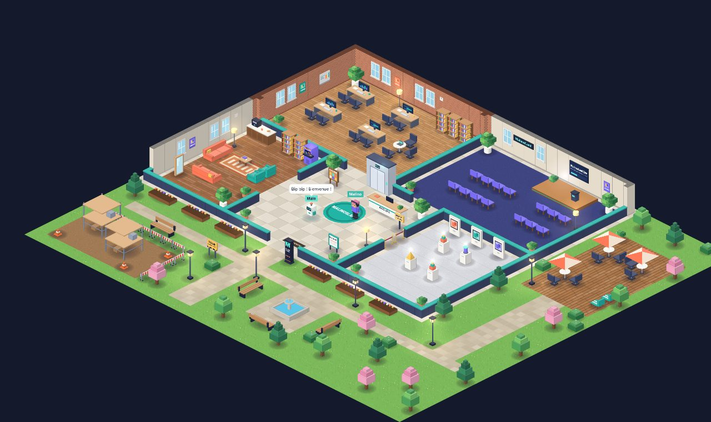
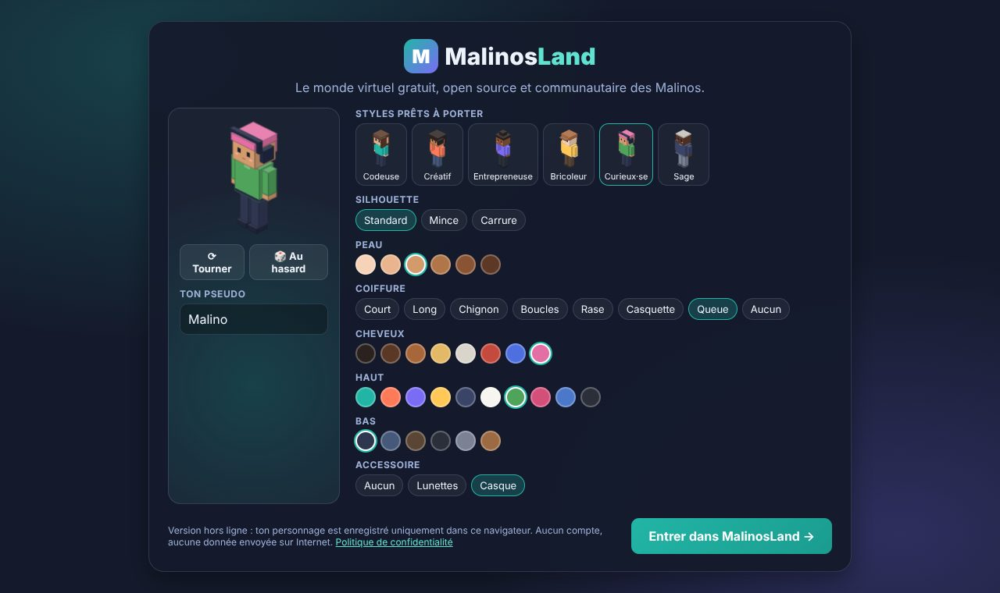
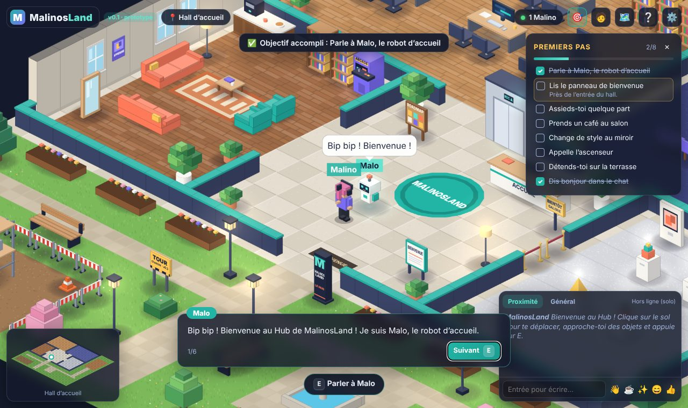
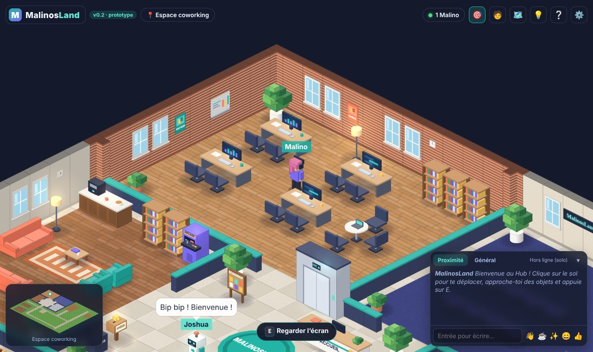
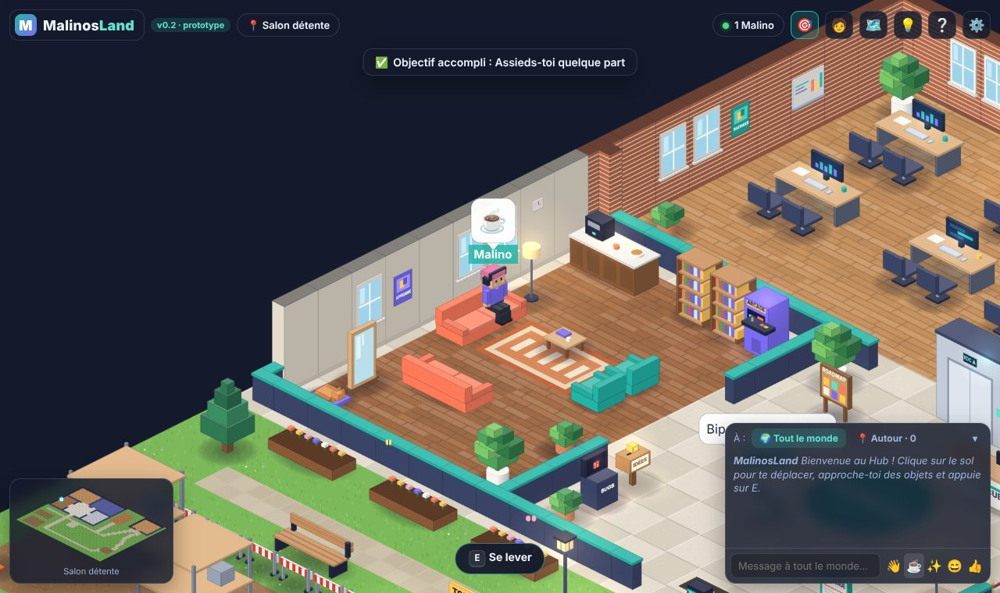

<div align="center">

# MalinosLand

**Le monde virtuel gratuit, open source et communautaire des Malinos.**



</div>

## C’est quoi, MalinosLand ?

MalinosLand est un **petit monde en 3D isométrique** (vu de trois quarts, comme une maquette),
qu’on visite directement **dans son navigateur**, sans rien installer.

Il est fait pour la communauté des **Malinos**, des passionnés d’intelligence artificielle. On y
crée son personnage, on se promène dans un grand bâtiment communautaire, on discute, et, au fil
des versions, on pourra y montrer ses projets, avoir son propre logement et participer à des
événements.

Trois promesses :

- 🆓 **Gratuit pour toujours** : pas d’abonnement, rien à acheter, aucune publicité.
- 🤝 **Construit ensemble** : le code est public, chacun peut proposer des idées ou des améliorations.
- 🪶 **Léger** : pensé pour fonctionner sur des ordinateurs modestes.

> **Où en est-on ?** La **version 0.1** est un **prototype** : on peut se promener, personnaliser
> son avatar et utiliser les objets, mais **on est encore seul** (pas de vrai multijoueur en ligne).
> Le multijoueur arrive en **version 0.2**. Voir la [feuille de route](docs/ROADMAP.md).

## En images

|                              Créer son personnage                               |                 Discuter avec Malo, le robot d’accueil                 |
| :-----------------------------------------------------------------------------: | :--------------------------------------------------------------------: |
|  |  |
|                           **Travailler au coworking**                           |                  **S’asseoir au salon avec un café**                   |
|                                   |                      |

Plus d’images et toutes les commandes dans le [guide du joueur](docs/GUIDE_DU_JOUEUR.md).

## La feuille de route en un coup d’œil

| Version                       | En une phrase                                                          | État               |
| ----------------------------- | ---------------------------------------------------------------------- | ------------------ |
| **0.1** — Prototype           | On visite le Hub, on crée son avatar, on utilise les objets.           | ✅ **Fait**        |
| **0.2** — Multijoueur         | On se connecte avec un compte et on voit les autres Malinos en direct. | 🔜 Prochaine étape |
| **0.3** — Chez soi            | Chacun reçoit un logement à décorer et choisit qui peut entrer.        | ⏳ Prévu           |
| **0.4** — Le monde s’agrandit | Étages, ascenseur, Galerie des projets, annuaire des membres.          | ⏳ Prévu           |
| **0.5** — Vie communautaire   | Événements, expositions, défis, mini-jeux.                             | ⏳ Prévu           |
| **1.0** — Version stable      | Un monde complet, sûr, bien modéré, toujours gratuit.                  | ⏳ Objectif        |

Le détail de chaque étape, expliqué simplement : [docs/ROADMAP.md](docs/ROADMAP.md).

## Essayer le jeu

Pour l’instant, le jeu n’est pas encore en ligne : il faut le lancer sur son ordinateur.

1. Installe [Node.js](https://nodejs.org) (version 20 ou plus récente) et [Git](https://git-scm.com).
2. Ouvre un terminal et tape :

   ```bash
   git clone https://github.com/Rogue06/MalinosLand.git
   cd MalinosLand
   npm install
   npm run dev
   ```

3. Ouvre **http://localhost:5173** dans ton navigateur, crée ton personnage… et bonne visite !

> Astuce : ouvre le jeu dans **deux onglets** du même navigateur pour voir deux personnages se
> croiser (c’est une démonstration locale, rien ne passe par Internet).

## Participer

Tout le monde peut aider, même sans savoir programmer :

| Tu es…                   | Tu peux…                                                                                                                              |
| ------------------------ | ------------------------------------------------------------------------------------------------------------------------------------- |
| 🎮 **Joueur ou curieux** | Tester le jeu, signaler un bug, proposer une idée ([ouvrir une « issue »](https://github.com/Rogue06/MalinosLand/issues/new/choose)). |
| 🎨 **Créatif**           | Proposer un objet, une décoration, une salle, des textes ou des astuces IA.                                                           |
| 💻 **Développeur**       | Corriger un bug, ajouter une fonctionnalité, améliorer les performances.                                                              |

👉 Commence par le [guide de contribution](docs/CONTRIBUTING.md) ; les mots techniques sont
expliqués dans le [glossaire](docs/GLOSSAIRE.md).

**Règle importante :** personne ne modifie directement la version principale (`main`). Chaque
proposition passe par une **pull request** (une demande de modification) qui est relue et validée
par le responsable du projet avant d’être ajoutée.

### 🤖 Tu codes avec une IA ? Commence par cette phrase

Que tu utilises Claude Code, Codex, Cursor, Copilot, Gemini ou un autre assistant, en local ou dans
le cloud, ouvre le projet puis donne-lui exactement ceci :

```text
Lis AGENTS.md puis docs/SESSION_HANDOFF.md. Résume-moi où en est le projet MalinosLand
et propose la prochaine étape. Respecte toutes les règles d'AGENTS.md
(gratuité permanente, travail sur une branche, pull request, documentation en français).
```

[`AGENTS.md`](AGENTS.md) contient toutes les règles du projet, et
[`docs/SESSION_HANDOFF.md`](docs/SESSION_HANDOFF.md) dit où en est le travail. La plupart des outils
lisent même `AGENTS.md` tout seuls. Ton IA saura donc quoi faire, comme toutes les autres. Mode
d’emploi complet : [Reprendre le projet](docs/REPRENDRE_LE_PROJET.md).

## Toute la documentation

Le [plan de la documentation](docs/README.md) t’indique quoi lire selon ton profil.

| Document                                               | Pour qui      | Contenu                                                 |
| ------------------------------------------------------ | ------------- | ------------------------------------------------------- |
| [Guide du joueur](docs/GUIDE_DU_JOUEUR.md)             | Tout le monde | Commandes, lieux, objectifs, réglages                   |
| [Feuille de route](docs/ROADMAP.md)                    | Tout le monde | Les prochaines versions, expliquées simplement          |
| [Vision du projet](docs/PROJECT_VISION.md)             | Tout le monde | Pourquoi MalinosLand existe, nos principes              |
| [Contribuer](docs/CONTRIBUTING.md)                     | Contributeurs | Comment proposer une modification, pas à pas            |
| [Reprendre le projet](docs/REPRENDRE_LE_PROJET.md)     | Contributeurs | Sur n’importe quel ordinateur, avec n’importe quelle IA |
| [Glossaire](docs/GLOSSAIRE.md)                         | Débutants     | Les mots techniques expliqués                           |
| [Architecture](docs/ARCHITECTURE.md)                   | Développeurs  | Comment le code est organisé                            |
| [Infrastructure gratuite](docs/FREE_INFRASTRUCTURE.md) | Développeurs  | Comment rester 100 % gratuit                            |

## Pour les développeurs

| Commande                               | Rôle                                                                                     |
| -------------------------------------- | ---------------------------------------------------------------------------------------- |
| `npm run dev`                          | Lance le jeu en mode développement (http://localhost:5173)                               |
| `npm run check`                        | Vérifie tout : types, style, tests, compilation — **à lancer avant chaque pull request** |
| `npm test`                             | Tests automatiques                                                                       |
| `npm run build` puis `npm run preview` | Version de production sur http://localhost:4173                                          |
| `npm run test:e2e`                     | Test complet dans un vrai navigateur (avec `preview` lancé)                              |
| `npm run docs:screenshots`             | Régénère les captures de la documentation (avec `preview` lancé)                         |

Galerie de tous les graphismes : `npm run dev` puis http://localhost:5173/art-preview.html.

Stack : TypeScript, [Phaser 4](https://phaser.io) (moteur de jeu), [Preact](https://preactjs.com)
(interface), [Vite](https://vite.dev). Tous les graphismes sont dessinés par le code : aucune image
à télécharger.

## Licence

Code sous licence [MIT](LICENSE) (proposition en attente de validation). Les graphismes, générés par
le code, suivent la même licence.
