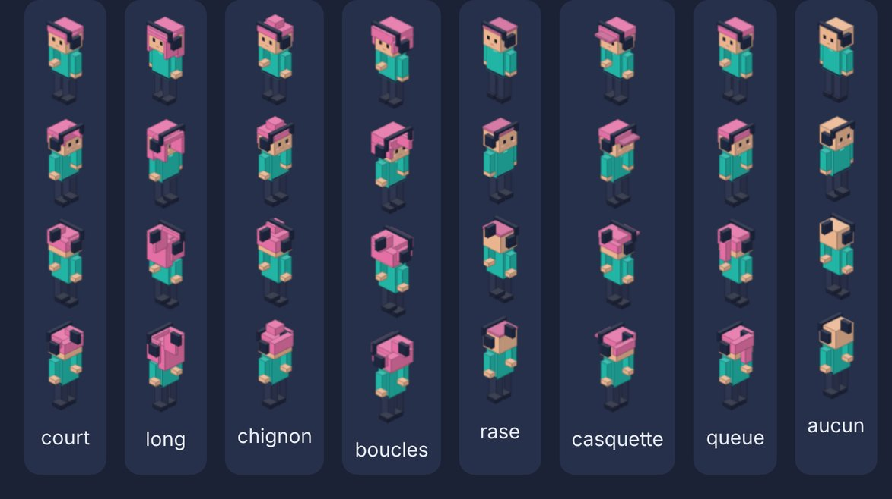

# Direction artistique

> **En bref (version simple)** : un style « petits cubes » (voxel) en vue de trois quarts, chaleureux et coloré. Tout est dessiné par le code, ce qui rend le jeu très léger et permet à chacun de proposer de nouveaux objets.

## 1. Analyse de la référence (DEKODE)

Points étudiés dans les captures fournies :

- Vue **isométrique fixe**, intérieurs visibles « en maison de poupée » : murs du fond hauts,
  murs avant et cloisons coupés bas pour voir l’intérieur.
- Volumes **voxel** simples, couleurs franches, ombrage par face (dessus clair, côtés plus sombres).
- Personnages « en blocs » lisibles, étiquettes de nom au-dessus de la tête.
- Mobilier de bureau détaillé (écrans allumés, classeurs, bibliothèques), plantes, posters.
- Accents de lumière (lampes, écrans) et petites touches de couleur saturée.

Ce que **nous ne reprenons pas** : graphismes, personnages, marques, interface, palette
(bleu nuit + orange), compteurs (abonnés, crédits, notoriété), économie de jeu.

## 2. Identité MalinosLand

- **Style** : isométrique 2:1 « voxel doux », dessiné par le code, contours légers, ombres de
  contact au sol, halos lumineux additifs (désactivés en qualité basse).
- **Ambiance** : moderne, chaleureuse, technologique et conviviale ; bois miel, briques, plantes,
  touches néon turquoise.
- **Lisibilité d’abord** : objets interactifs en surbrillance au survol, étiquettes courtes.

### Palette (`src/game/art/palette.ts`)

| Rôle               | Couleur               |
| ------------------ | --------------------- |
| Nuit (fond)        | `#141a2b`             |
| Encre / UI         | `#1f2740`             |
| Ardoise (cloisons) | `#3a4466`             |
| Turquoise (marque) | `#22b5a6` / `#5fe3d0` |
| Corail (chaleur)   | `#ff7a59`             |
| Soleil (accents)   | `#ffc857`             |
| Violet (IA, tech)  | `#7b6cf6`             |
| Bois miel          | `#c98f5a`             |
| Brique             | `#b5694a`             |
| Enduit             | `#e6dccb`             |

### Avatars et accessoires

Les accessoires portés sur la tête (casque…) s’appuient sur le volume de chaque coiffure
(`HAIR_BOUNDS` dans `src/game/art/characters.ts`) pour ne jamais passer à travers les cheveux.
Un test automatique le vérifie pour chaque coiffure : si tu en ajoutes une, déclare son volume.

### Proportions

- Tuile : 64 × 32 px (projection 2:1) ; une unité de hauteur = 32 px.
- Murs hauts : 2,6 unités ; cloisons basses : 0,8 ; assise : ≈ 0,4.
- Avatar : ≈ 1,6 unité de haut, gabarit ×1,32 ; tête volontairement grande (style « chibi » léger).

### Lumière et ombres

- Faces : dessus éclairci (+14 %), face +y couleur de base, face +x assombrie (−20 %).
- Ombres de contact douces sous chaque objet ; halos additifs pour lampes, écrans, réverbères.

## 3. Contraintes techniques

- 0 image à télécharger en v0.1 ; textures générées à la résolution ×2 (×1 en qualité basse),
  regroupées en atlas 2048².
- Textes sur les objets en police système (pas de police téléchargée).
- Animations légères : marche en 4 images, flottement du robot ; désactivables.

## 4. Contribuer des graphismes

1. Dessiner un objet dans `src/game/art/objects.ts` avec `IsoBuilder` (boîtes, cylindres,
   polygones, décors de face, textes) en orientation canonique (l’objet regarde +y).
2. Vérifier les 4 rotations dans `/art-preview.html` (`npm run dev`).
3. Respecter la palette et la lisibilité ; pas de copie d’une œuvre existante.

**Licences des ressources.** Les graphismes générés par le code sont sous la licence du dépôt (AGPL-3.0).
Toute ressource externe future (PNG, polices, sons) devra être sous licence libre compatible
(CC0, CC BY 4.0, OFL…), créditée dans un fichier `CREDITS.md`, et validée en revue.
