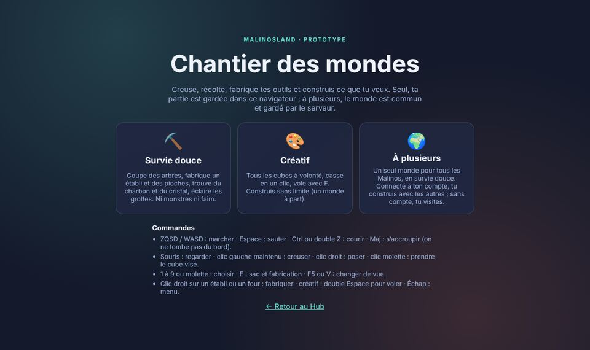
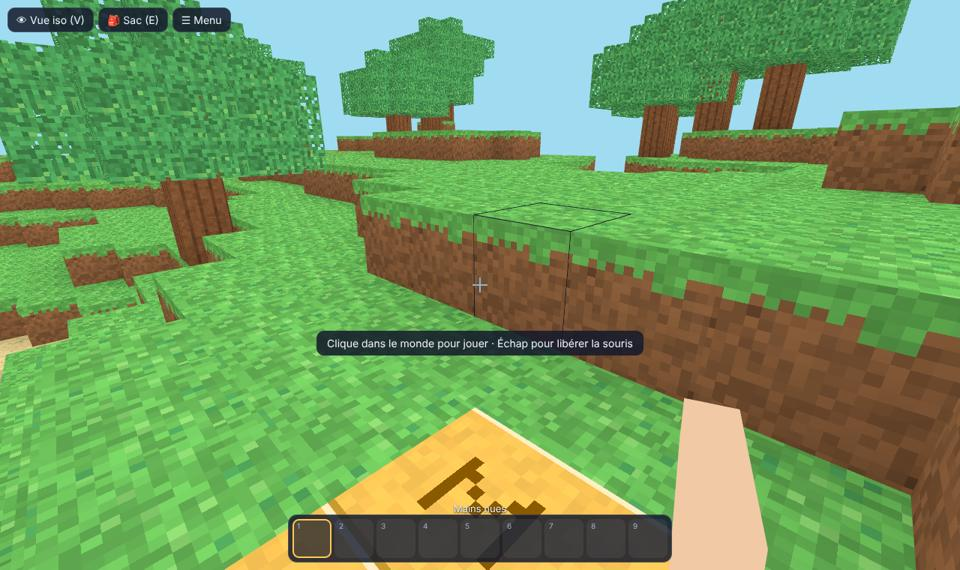
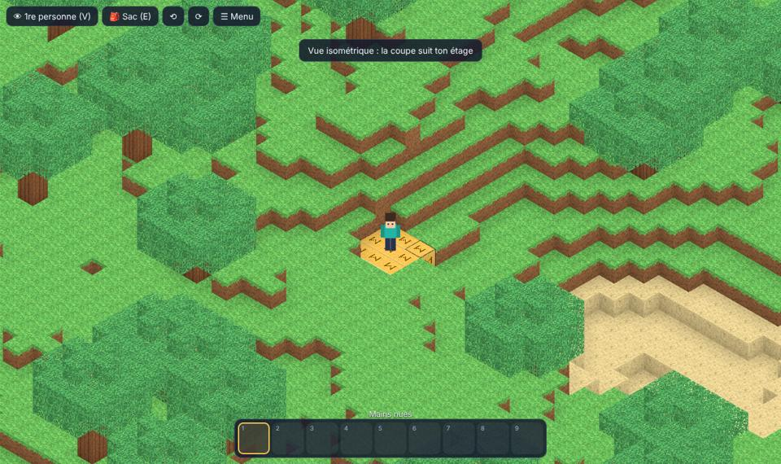
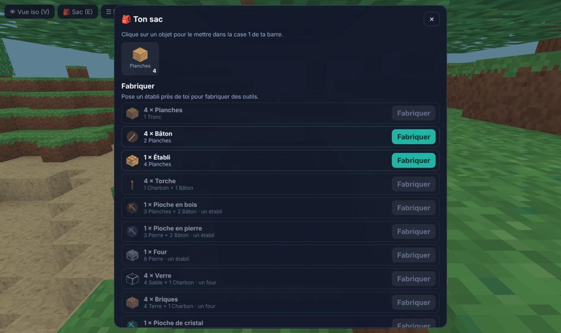
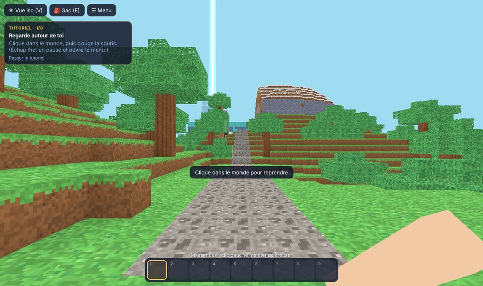
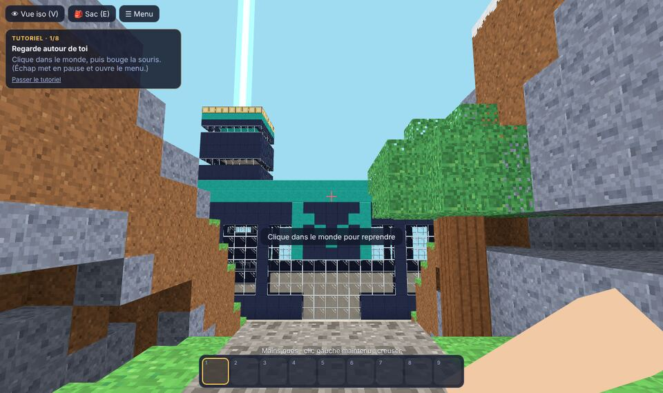
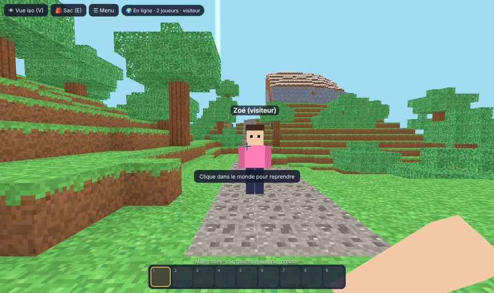

# Chantier des mondes (prototype du bac à sable en cubes)

> **En bref.** Un vrai petit jeu de construction en cubes, à part du Hub : on creuse, on récolte,
> on fabrique ses outils et on bâtit, en **première personne** ou en **vue isométrique** (au
> choix du joueur). Gameplay inspiré des jeux de construction en cubes ; textures, noms et
> dessins propres à MalinosLand. C’est le **palier B0** du
> [cahier des charges](CAHIER_DES_CHARGES_VILLAGE.md) (§13), sur une page à part (`/chantier/`)
> que le jeu ne relie pas encore. On y joue **seul** (partie gardée dans le navigateur) ou **à
> plusieurs** dans un monde commun gardé par le serveur (DEC-045). Moteur 3D : Three.js (DEC-043).

## L’essayer

- **En local** : `npm run dev`, puis <http://localhost:5173/chantier/>.
- **En ligne** (si le responsable autorise la mise en ligne de cette page) :
  `https://malinosland.pages.dev/chantier/`. Elle n’est reliée à rien dans le jeu et n’est pas
  indexée par les moteurs de recherche.

Trois modes, trois mondes séparés (ce qu’on obtient en créatif ne passe jamais en survie) :

- **Survie douce** : on part les mains vides. Ni monstres, ni faim, ni perte d’objets.
- **Créatif** : tous les cubes à volonté, on casse en un clic, on peut voler (double Espace ou
  F) et annuler (Ctrl+Z).
- **À plusieurs** : la survie douce dans **un seul monde pour tous** (voir plus bas).

## Jouer

Les touches sont celles des jeux de construction en cubes les plus connus (sur un clavier
français, ZQSD remplace WASD automatiquement). Elles se **changent** dans le menu → ⌨️ Touches.
Pour monter sur un cube, il faut **sauter**. Échap met le jeu en pause et ouvre le menu ; en
fermant le sac ou le menu, on reprend la main tout de suite.

| Action                               | Clavier et souris                                                               | Au doigt                                                 |
| ------------------------------------ | ------------------------------------------------------------------------------- | -------------------------------------------------------- |
| Marcher, sauter, courir, s’accroupir | ZQSD / WASD ou flèches, Espace, Ctrl ou double Z, Maj (on ne tombe pas du bord) | Manette à gauche, ⤒                                      |
| Regarder (1re personne)              | Souris (clic pour « attraper » la souris, Échap pour la libérer)                | Glisser l’écran                                          |
| Creuser                              | Clic gauche **maintenu**                                                        | ⛏ maintenu (1re personne) ; ⛏ puis toucher un cube (iso) |
| Poser (le cube choisi dans la barre) | Clic droit, ou Ctrl + clic                                                      | 🧱 (1re personne) ; 🧱 puis toucher une face (iso)       |
| Choisir dans la barre                | 1 à 9, molette                                                                  | Toucher une case                                         |
| Sac et fabrication                   | E (ou clic droit sur un établi / un four)                                       | 🎒 Sac                                                   |
| Changer de vue                       | F5 ou V                                                                         | 👁                                                        |
| Prendre le cube visé                 | Clic molette                                                                    | —                                                        |
| Voler (créatif)                      | Double Espace ou F ; Espace monte, Maj descend                                  | —                                                        |
| Tourner / zoomer (iso)               | R, molette                                                                      | ⟲ ⟳, deux doigts                                         |

En vue isométrique, quand le personnage passe sous un toit ou sous terre, les couches du dessus
disparaissent : on voit toujours son étage (coupe automatique).

## Tutoriel

En survie douce, une carte en haut à gauche guide les premiers pas : regarder, marcher, couper
un tronc, fabriquer des planches puis un établi, la pioche en bois, creuser de la pierre et
construire. Chaque étape se valide toute seule quand on l’a faite. On peut le passer, et le
revoir depuis le menu (« 📘 Revoir le tutoriel »).

## Ce qu’on y fait (survie douce)

1. **Couper un arbre** (clic maintenu sur un tronc) : un petit cube de tronc tombe au sol ; il
   arrive dans le sac (« pop ») quand on passe à côté. Les objets au sol restent tant qu’on ne vient
   pas les chercher.
2. **Fabriquer** dans le sac : planches, bâtons, puis un **établi** à poser près de soi.
3. À l’établi : **pioche en bois**, puis **pioche en pierre** (on creuse bien plus vite), un
   **four**.
4. Sous terre, dans les **grottes** : du **charbon** (torches, verre et briques au four) et du
   **cristal** (il faut une pioche en pierre), pour la **pioche de cristal** et les blocs
   turquoise. Les grottes et les maisons fermées sont sombres : les **torches** éclairent.
5. **Construire** : 15 sortes de cubes (herbe, terre, pierre, planches, tronc, feuillage, verre,
   sable, briques, turquoise, corail, établi, four…), et les torches.

12 recettes au total. Une fabrication vérifie tout avant de retirer quoi que ce soit : elle ne
peut ni dupliquer ni perdre d’objets.

## Le monde et le Hub au loin

Le monde fait **192 × 192 cubes au sol et 48 de haut** (neuf fois la surface du premier
prototype) : collines, forêts, **montagnes enneigées**, plages de sable, grottes sous terre. On
démarre au sud, sur une **dalle de départ protégée** (bouton « Revenir au départ » dans le menu si
l’on est coincé). Un **chemin de gravier** mène vers le nord, jusqu’au **Hub des Malinos**, construit
en cubes : grand hall sombre aux bandes turquoise, logo « M », entrée vitrée, lanternes et la
**tour** des futurs logements. Un **faisceau de lumière** part du haut de la tour : on le voit de
partout, même à travers la brume.

Le Hub est **protégé** (on ne peut ni le casser ni construire dessus, ni juste autour) et on ne
peut **pas encore y entrer** : c’est le même Hub que celui du jeu, vu de dehors. Les deux mondes
seront reliés plus tard, quand le Chantier sera prêt (décision du responsable).

Pour rester fluide, le monde est découpé en **tranches de 16 × 16 cubes**, calculées seulement
quand on s’en approche, puis dessinées petit à petit (les plus proches d’abord). Au-delà de la
**distance de vue**, les tranches sont cachées, sauf celles du Hub. Menu → « 🔭 Distance de vue » :
courte (5 tranches), normale (7) ou longue (11), à baisser sur une machine modeste.

## À plusieurs (survie partagée)

Un seul monde pour tous les Malinos, le même grand monde que la survie douce (même terrain de
départ, même Hub au loin). Choix du responsable (27/10) :

- **Connecté à son compte** (le compte du Hub : Google ou GitHub, même site, même connexion), on
  **construit** : casser, poser, fabriquer. Le **sac** et la position de chacun sont gardés par
  le serveur : on les retrouve d’un appareil à l’autre.
- **Sans compte**, on **visite** : on se promène et on regarde les autres construire (son pseudo
  du Hub s’affiche, avec « visiteur »). Menu → « 🔑 Se connecter dans le Hub pour construire ».
- On voit les autres joueurs (un petit Malino en cubes, d’une couleur à lui, avec son pseudo),
  leurs constructions et les éclats des cubes qu’ils cassent. En haut : « 🌍 En ligne · 3
  joueurs ».

**Le serveur décide de tout** (le navigateur ne fait que demander) : zone protégée (Hub, dalle de
départ), portée des mains, temps pour casser selon l’outil (pas de cubes cassés trop vite),
objets réellement dans le sac, établi ou four à côté pour les recettes qui en demandent,
déplacements trop rapides refusés (le joueur est replacé). Le jeu montre tout de suite ce que fait
le joueur ; si le serveur refuse, la case et le sac reviennent à leur état réel, avec un message.

Limites (offre gratuite) : **20 joueurs** à la fois ; un budget de messages par jour à côté de
celui du Hub. S’il est épuisé, le monde partagé fait une pause jusqu’au lendemain (les modes solo
restent ouverts). Pas encore de chat dans le Chantier (le chat est dans le Hub), ni d’outils de
modération ou de retour en arrière : ce sera la PR suivante (protections et modération).

## Sauvegarde et limites gratuites

- La partie est gardée **dans le navigateur** (rien n’est envoyé) : seules les
  **modifications** du terrain sont enregistrées (le terrain de départ se recalcule à
  l’identique), plus le sac et la position. Quelques centaines de Ko au plus (60 000
  modifications au plus).
- Les parties commencées sur l’ancien petit monde (64 × 64) **ne sont pas reprises** : le terrain
  a changé, on recommence sur le grand monde.
- En solo, aucune ressource en ligne n’est utilisée.
- À plusieurs, le monde est gardé par le serveur temps réel (Cloudflare, offre gratuite) : une
  ligne par tranche modifiée et une par compte (sac et position), écrites par lots toutes les
  5 secondes environ. Si le serveur redémarre pile dans ces 5 secondes, les dernières
  modifications peuvent être perdues.

## Mesures (prototype)

| Mesure                           | Valeur                     | Remarque                                                                                                              |
| -------------------------------- | -------------------------- | --------------------------------------------------------------------------------------------------------------------- |
| Poids de Three.js                | 531 Ko (132 Ko compressés) | Chargé **seulement** sur `/chantier/`, fichier à part (en cache ensuite)                                              |
| Poids de la page du jeu de cubes | 66 Ko (24 Ko compressés)   | Plus 7 Ko de styles                                                                                                   |
| Images par seconde               | ≈ 10 à 11                  | Mesuré **sans carte graphique** (rendu logiciel de la session) : à mesurer sur une vraie machine et un vrai téléphone |
| Triangles affichés               | ≈ 325 000                  | Distance de vue normale ; seules les faces visibles sont dessinées                                                    |
| Temps pour tout dessiner         | ≈ 28 s                     | Sans carte graphique ; on joue dès le début (les tranches proches sont dessinées en premier)                          |

Le menu « 📊 Mesures » affiche ces chiffres en jouant.

## Ce qui n’est pas fait (volontairement, pour ce prototype)

- À plusieurs : pas encore de chat, de zones protégées par joueur ni de retour en arrière (PR
  suivante) ; pas de collisions vérifiées par le serveur (seulement la vitesse).
- Eau, nuit, monstres, faim, coffres, objets qui s’usent : rien de tout cela pour l’instant.
- La lumière est simplifiée (ciel, ombre sous les toits, torches à portée), pas une vraie
  propagation.
- Pas de lien depuis le Hub : un portail viendra au palier B4, si le prototype plaît. Le Hub
  en cubes ne s’ouvre pas encore.

## Ce que le responsable a décidé (26/10)

- Vue préférée : la **3D à la première personne** (la vue isométrique reste disponible).
- Graphismes : validés (« top »).
- Intégration future dans le Hub (palier B4) : un **lore** pour faire la transition vers la 3D, en
  rapport avec l’IA. Piste du responsable : les **bornes d’arcade** de la salle de jeux, avec de
  vieux jeux (Pong…) et un décor assorti ; l’une d’elles ouvrirait le Chantier des mondes.

## Ce que le responsable a décidé (27/10)

- **Un monde plus grand** à explorer (**192 × 192**), d’où l’on voit **le Hub au loin** : le
  Chantier n’est pas un monde à part, les deux seront reliés, mais **pas avant** que le Chantier
  soit prêt.
- **Jouer à plusieurs** : une **survie partagée** (un seul monde commun, le sac de chacun gardé
  par le serveur) ; seuls les **comptes connectés** peuvent construire, les visiteurs regardent.
  Ce sera la suite (PR 68), puis protections et modération (PR 69).

## Questions pour la suite (au responsable)

1. Laquelle des deux vues donne le plus envie : première personne, isométrique, ou les deux ?
2. Le rythme de la survie douce (temps pour casser, recettes) : trop lent, trop rapide ?
3. À plusieurs : faut-il un chat dans le Chantier, ou celui du Hub suffit-il ?

## Pour les développeurs

`src/sandbox/` : `world.ts` (terrain par tranches calculées à la demande, Hub, règles, lancer de
rayon ; DEC-044), `player.ts` (déplacements),
`inventory.ts` (sac et recettes), `mesh.ts` (maillages, lumière) : logique pure, testée par
`tests/sandbox.test.ts`. `textures.ts`, `game.ts` (Three.js, caméras, commandes), `main.ts`
(interface), `sfx.ts` (bruitages Web Audio). Ajouter `?debug` à l’URL expose
`window.__chantier()` (la partie en cours) pour les tests de bout en bout.

À plusieurs : `protocol.ts` (messages, validation, tranches compactes ; testé par
`tests/sandbox-protocol.test.ts`), `online.ts` (connexion, jeton du compte), et côté serveur
`server/src/chantier.ts` (règles, logique pure testée par `tests/chantier-server.test.ts`) et
`server/src/ChantierRoom.ts` (Durable Object, stockage). Détails :
[REALTIME_NETWORK.md](REALTIME_NETWORK.md) et DEC-045.
