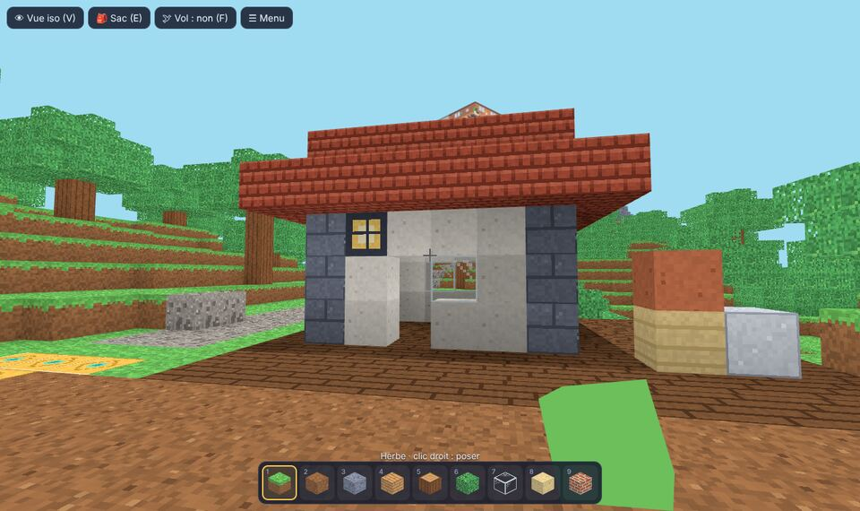
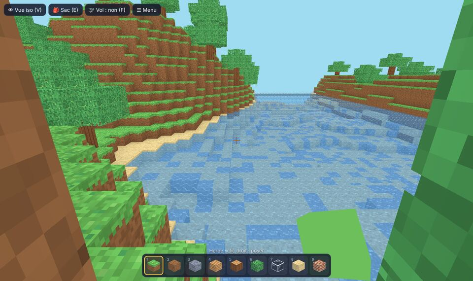
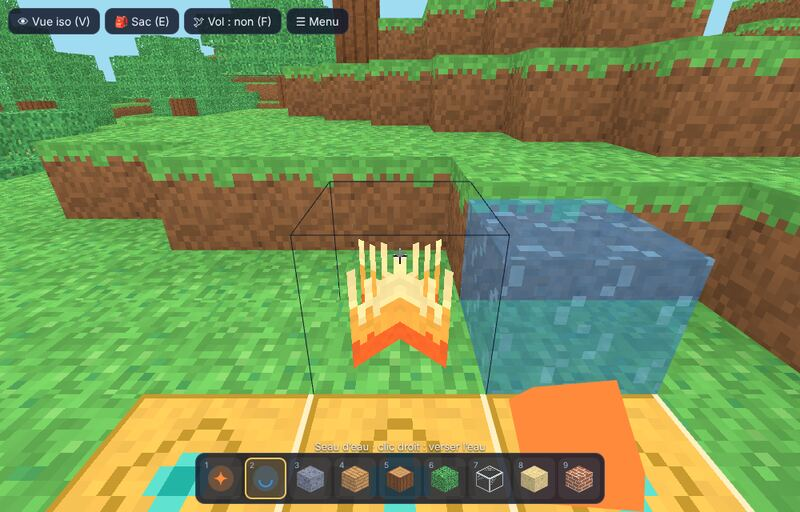
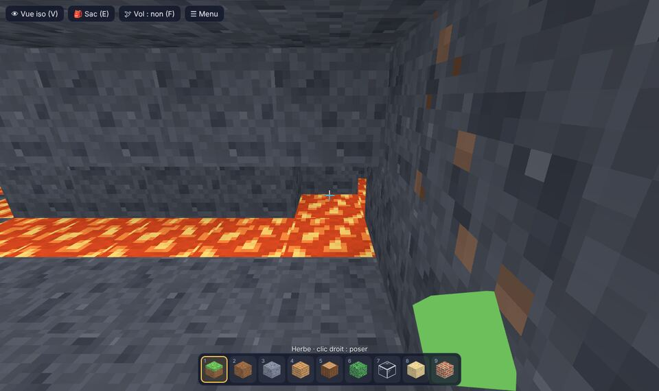
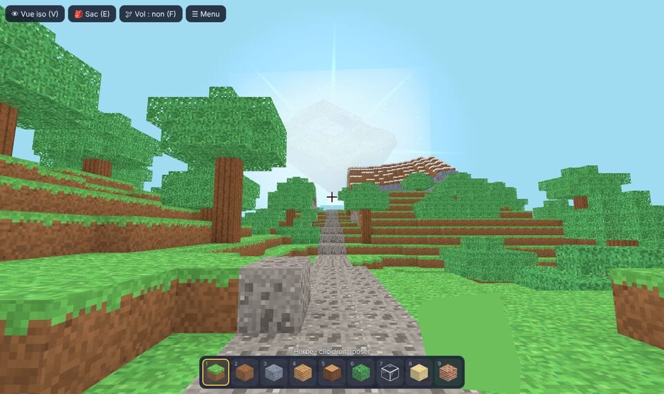
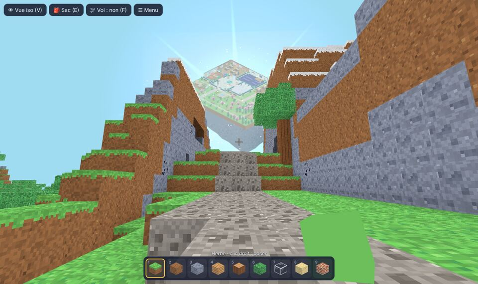
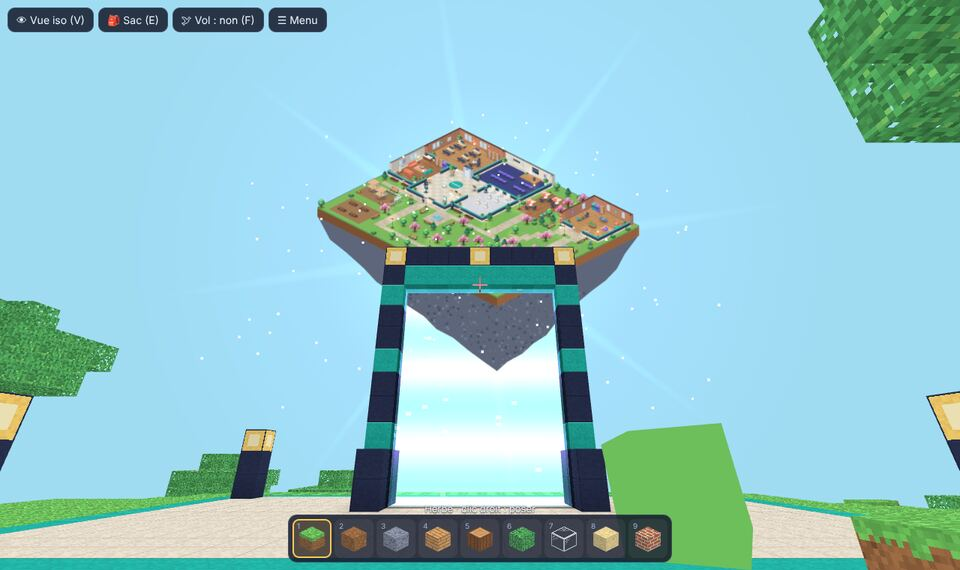
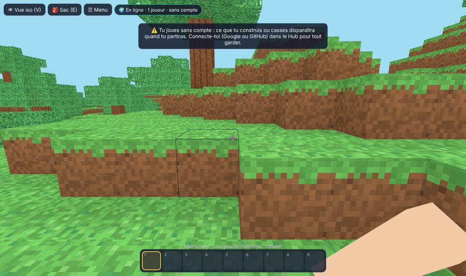
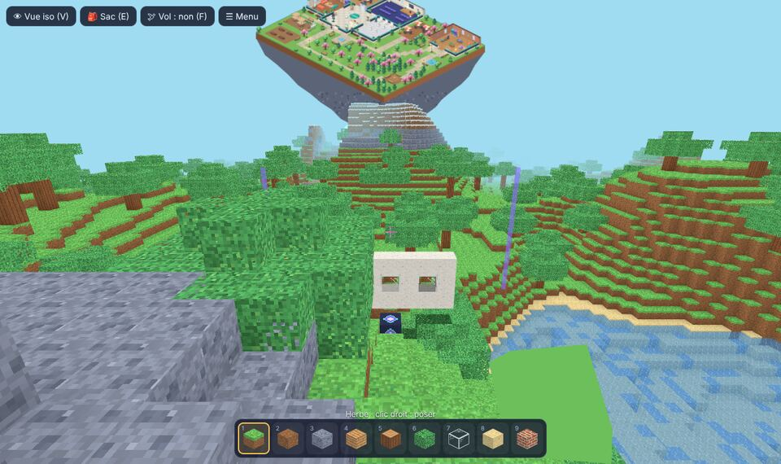

# Chantier des mondes (prototype du bac à sable en cubes)

> **En bref.** Un vrai petit jeu de construction en cubes, à part du Hub : on creuse, on récolte,
> on fabrique ses outils et on bâtit, en **première personne** ou en **vue isométrique** (au
> choix du joueur). Gameplay inspiré des jeux de construction en cubes ; textures, noms et
> dessins propres à MalinosLand. C’est le **palier B0** du
> [cahier des charges](CAHIER_DES_CHARGES_VILLAGE.md) (§13), sur une page à part (`/chantier/`)
> que le jeu ne relie pas encore. On y joue **tous ensemble**, dans un seul monde gardé par le
> serveur (DEC-045, DEC-049). Moteur 3D : Three.js (DEC-043).

## L’essayer

- **En local** : `npm run dev`, puis <http://localhost:5173/chantier/>.
- **En ligne** (si le responsable autorise la mise en ligne de cette page) :
  `https://malinosland.pages.dev/chantier/`. Elle n’est reliée à rien dans le jeu et n’est pas
  indexée par les moteurs de recherche.

Un seul mode, décidé par le responsable (27/10) : la **survie douce à plusieurs**, dans un seul
monde pour tous (on part les mains vides ; ni monstres, ni faim, ni perte d’objets). Les anciens
modes solo et créatif ne sont plus proposés aux joueurs ; ils restent pour les essais et les tests
des développeurs, avec l’adresse `/chantier/?essai` (hors ligne, rien n’est envoyé).

## Jouer

Les touches sont celles des jeux de construction en cubes les plus connus (sur un clavier
français, ZQSD remplace WASD automatiquement). Elles se **changent** dans le menu → ⌨️ Touches.
Pour monter sur un cube, il faut **sauter**. Échap met le jeu en pause et ouvre le menu ; en
fermant le sac ou le menu, on reprend la main tout de suite.

| Action                               | Clavier et souris                                                               | Au doigt                                                 |
| ------------------------------------ | ------------------------------------------------------------------------------- | -------------------------------------------------------- |
| Marcher, sauter, courir, s’accroupir | ZQSD / WASD ou flèches, Espace, Ctrl ou double Z, Maj (on ne tombe pas du bord) | Manette à gauche, ⤒                                      |
| Regarder (1re personne)              | Souris (clic pour « attraper » la souris, Échap pour la libérer)                | Glisser l’écran                                          |
| Creuser                              | Clic gauche **maintenu**                                                        | ⛏ maintenu (1re personne) ; ⛏ puis toucher un cube (iso) |
| Poser (le cube choisi dans la barre) | Clic droit, ou Ctrl + clic                                                      | 🧱 (1re personne) ; 🧱 puis toucher une face (iso)       |
| Choisir dans la barre                | 1 à 9, molette                                                                  | Toucher une case                                         |
| Sac et fabrication                   | E (ou clic droit sur un établi / un four)                                       | 🎒 Sac                                                   |
| Changer de vue                       | F5 ou V                                                                         | 👁                                                        |
| Prendre le cube visé                 | Clic molette                                                                    | —                                                        |
| Voler (créatif)                      | Double Espace ou F ; Espace monte, Maj descend                                  | —                                                        |
| Tourner / zoomer (iso)               | R, molette                                                                      | ⟲ ⟳, deux doigts                                         |

En vue isométrique, quand le personnage passe sous un toit ou sous terre, les couches du dessus
disparaissent : on voit toujours son étage (coupe automatique).

## Tutoriel

En survie douce, une carte en haut à gauche guide les premiers pas : regarder, marcher, couper
un tronc, fabriquer des planches puis un établi, la pioche en bois, creuser de la pierre et
construire. Chaque étape se valide toute seule quand on l’a faite. On peut le passer, et le
revoir depuis le menu (« 📘 Revoir le tutoriel »).

## Ce qu’on y fait (survie douce)

1. **Couper un arbre** (clic maintenu sur un tronc) : un petit cube de tronc tombe au sol ; il
   arrive dans le sac (« pop ») quand on passe à côté. Les objets au sol restent tant qu’on ne vient
   pas les chercher.
2. **Fabriquer** dans le sac : planches, bâtons, puis un **établi** à poser près de soi.
3. À l’établi : **pioche en bois**, puis **pioche en pierre** (on creuse bien plus vite), un
   **four**.
4. Sous terre, dans les **grottes** : du **charbon** (torches, verre et briques au four) et du
   **cristal** (il faut une pioche en pierre), pour la **pioche de cristal** et les blocs
   turquoise. Les grottes et les maisons fermées sont sombres : les **torches** éclairent.
5. Encore plus bas, avec une pioche en pierre : le **fer**. Au four (avec du charbon), il donne des
   **lingots** : **pioche en fer**, **seau**, **lanternes**, **bloc de fer**, et le **briquet**
   (avec un **silex**, caché de temps en temps dans le **gravier**).
6. Au fond des **lacs** : de l’**argile**, qui donne au four la **terre cuite**, puis des
   **tuiles** pour les toits.
7. **Construire** : 27 sortes de cubes. Herbe, terre, pierre, planches et planches foncées,
   tronc, feuillage, verre, sable, grès, briques, briques de pierre, enduit blanc, terre cuite,
   tuiles, bloc de fer, lanternes, turquoise, corail, établi, four… et les torches.

24 recettes au total. Une fabrication vérifie tout avant de retirer quoi que ce soit : elle ne
peut ni dupliquer ni perdre d’objets.

### L’eau et le feu

- **Lacs** dans les plaines, avec leurs plages de sable. On **nage** : on avance plus lentement,
  on coule doucement, on remonte en gardant **Espace** appuyé ; contre un bord, Espace fait sortir
  de l’eau. Sous l’eau, tout devient bleu.
- **Seau** (3 lingots de fer) : clic droit en visant l’eau pour le remplir, clic droit ailleurs
  pour la verser. L’eau des lacs ne s’épuise pas ; un cube d’eau versé se reprend. On peut
  construire dans l’eau : un cube posé prend sa place. Si l’on creuse à côté de l’eau, elle vient
  remplir le trou.
- **Briquet** (1 lingot + 1 silex) : clic droit sur le dessus d’un cube pour allumer un **feu**
  qui éclaire et dont les flammes dansent. Un coup l’éteint ; il tombe si l’on casse son cube.

- **Bruit de l’eau** : « plouf » en entrant, puis des vagues douces tant qu’on nage.
- **Au fond des grottes** : de la **lave** tout en bas (elle brille dans le noir ; y tomber
  renvoie à la dalle de départ, le sac intact) et, par endroits, des **lacs souterrains**. Creusé
  à côté de la lave, un trou se remplit de lave : on creuse prudemment.

Pour rester simple (et juste à plusieurs), l’eau **ne coule pas** comme dans les jeux de cubes :
un cube d’eau versé reste un cube ; seule une case creusée à côté de l’eau se remplit. Le feu **ne
se propage pas** et ne brûle rien : pas de risque de voir disparaître les constructions des
autres. Il n’y a pas de points de vie.

## Le monde, le portail et MalinosLand au loin

Le monde fait **192 × 192 cubes au sol et 48 de haut** (neuf fois la surface du premier
prototype) : collines, forêts, **montagnes enneigées**, plages de sable, grottes sous terre. On
démarre au sud, sur une **dalle de départ protégée** (bouton « Revenir au départ » dans le menu si
l’on est coincé). Un **chemin de gravier** mène vers le nord, jusqu’au **Portail des Malinos** :
une place dallée, des lanternes et une grande arche où chatoie une surface turquoise.

Derrière le portail, dans le ciel, flotte **MalinosLand**, le vrai jeu en 2D isométrique (le
Hub, le jardin, le musée…) posé sur une île. **De loin, c’est un mirage** : pâle, dans une brume
de la couleur du ciel, au cœur d’un **halo étoilé** turquoise et violet qui attire l’œil de
partout. **En approchant du portail**, la brume se lève, l’île prend ses couleurs et grandit, des
étincelles montent autour d’elle. Un **pont de lumière** relie l’arche à l’île. C’est
la promesse du passage entre les deux mondes : plus tard, les Malinos du Hub pourront venir ici,
et ceux d’ici retourner dans le Hub, par ce portail (décision du responsable, 27/10). Pour
l’instant, traverser l’arche affiche « le passage ouvrira bientôt ».

L’image de MalinosLand est une **vraie capture du jeu** (sans interface, fond transparent, île
dessinée dessous), refaite quand le Hub change : `npm run build && npm run preview`, puis
`npm run chantier:vue` (fichier `src/sandbox/assets/malinosland.webp`, ≈ 200 Ko). Le portail
est **protégé** (on ne le casse pas et on ne construit pas tout contre).

Pour rester fluide, le monde est découpé en **tranches de 16 × 16 cubes**, calculées seulement
quand on s’en approche, puis dessinées petit à petit (les plus proches d’abord). Au-delà de la
**distance de vue**, les tranches sont cachées, sauf celles du portail (l’île et le pont de
lumière restent toujours visibles). Menu → « 🔭 Distance de vue » :
courte (5 tranches), normale (7) ou longue (11), à baisser sur une machine modeste.

## À plusieurs (survie partagée)

Un seul monde pour tous les Malinos, le même grand monde que la survie douce (même terrain de
départ, même portail et MalinosLand au loin). Choix du responsable (27/10) :

- **Connecté à son compte** (le compte du Hub : Google ou GitHub, même site, même connexion), on
  **construit pour de bon** : casser, poser, fabriquer. Le **sac** et la position de chacun sont
  gardés par le serveur : on les retrouve d’un appareil à l’autre.
- **Sans compte**, on peut **essayer** : casser ou poser **60 cubes** au plus (un rappel à 40),
  puis il faut se connecter. Rien n’est gardé : quand on part, tout ce qu’on a cassé ou posé
  revient comme avant. Un message le dit à l’arrivée, et le menu propose de se connecter dans le
  Hub.

- On voit les autres joueurs (un petit Malino en cubes, d’une couleur à lui, avec son pseudo),
  leurs constructions et les éclats des cubes qu’ils cassent. En haut : « 🌍 En ligne · 3
  joueurs ».

**Le serveur décide de tout** (le navigateur ne fait que demander) : zone protégée (portail, dalle de
départ), portée des mains, temps pour casser selon l’outil (pas de cubes cassés trop vite),
objets réellement dans le sac, établi ou four à côté pour les recettes qui en demandent,
déplacements trop rapides refusés (le joueur est replacé). Le jeu montre tout de suite ce que fait
le joueur ; si le serveur refuse, la case et le sac reviennent à leur état réel, avec un message.

Limites (offre gratuite) : **20 joueurs** à la fois ; un budget de messages par jour à côté de
celui du Hub. S’il est épuisé, le monde partagé fait une pause jusqu’au lendemain. Pas encore de chat dans le Chantier (le chat est dans le Hub).

### Protéger sa maison : la borne de protection

- La **borne de protection** se fabrique à l’établi (4 lingots de fer + 1 cristal). Posée par un
  joueur connecté à son compte, elle protège les **17 × 17 colonnes** autour d’elle, sur toute la
  hauteur : personne d’autre n’y casse ni n’y pose rien. Quatre fins piliers violets marquent
  les coins de la zone ; en y entrant, un message dit à qui elle est.
- **Deux zones** par compte au plus, pas collées à une autre zone, ni au portail, ni à la dalle
  de départ (lieux communs). Casser sa borne retire la protection (on récupère la borne).
- **Deux semaines** sans visite ni construction dans la zone : la borne s’éteint, puis la maison
  **se défait petit à petit** (quelques cubes par heure) jusqu’au terrain de départ. Chaque
  visite renouvelle la protection ; le menu indique les jours qui restent.

### Un monde qui ne se vide pas

Quand beaucoup de cubes ont été retirés du monde (plus de 4 000), les **trous de surface se
referment peu à peu** (80 cases par heure au plus, par le fond), seulement dans les endroits que
personne n’a touchés depuis deux jours, hors des zones protégées et loin des joueurs. Les
**galeries creusées en profondeur restent**.

### Modération

Les modérateurs (et le responsable du site) ont un bouton « 🛡️ Modération » dans le menu :
**annuler** ce qu’un joueur a changé dans la dernière heure (si personne ne l’a retouché depuis),
ou **l’exclure** du monde partagé pour une heure. Ils peuvent aussi réparer eux-mêmes dans une
zone protégée. Tout est vérifié par le serveur, jamais seulement dans l’interface.

## Sauvegarde et limites gratuites

- La partie est gardée **dans le navigateur** (rien n’est envoyé) : seules les
  **modifications** du terrain sont enregistrées (le terrain de départ se recalcule à
  l’identique), plus le sac et la position. Quelques centaines de Ko au plus (60 000
  modifications au plus).
- Les parties commencées sur l’ancien petit monde (64 × 64) **ne sont pas reprises** : le terrain
  a changé, on recommence sur le grand monde.
- En solo, aucune ressource en ligne n’est utilisée.
- À plusieurs, le monde est gardé par le serveur temps réel (Cloudflare, offre gratuite) : une
  ligne par tranche modifiée et une par compte (sac et position), écrites par lots toutes les
  5 secondes environ. Si le serveur redémarre pile dans ces 5 secondes, les dernières
  modifications peuvent être perdues.

## Mesures (prototype)

| Mesure                           | Valeur                     | Remarque                                                                                                              |
| -------------------------------- | -------------------------- | --------------------------------------------------------------------------------------------------------------------- |
| Poids de Three.js                | 531 Ko (132 Ko compressés) | Chargé **seulement** sur `/chantier/`, fichier à part (en cache ensuite)                                              |
| Poids de la page du jeu de cubes | 66 Ko (24 Ko compressés)   | Plus 7 Ko de styles                                                                                                   |
| Images par seconde               | ≈ 10 à 11                  | Mesuré **sans carte graphique** (rendu logiciel de la session) : à mesurer sur une vraie machine et un vrai téléphone |
| Triangles affichés               | ≈ 325 000                  | Distance de vue normale ; seules les faces visibles sont dessinées                                                    |
| Temps pour tout dessiner         | ≈ 28 s                     | Sans carte graphique ; on joue dès le début (les tranches proches sont dessinées en premier)                          |

Le menu « 📊 Mesures » affiche ces chiffres en jouant.

## Ce qui n’est pas fait (volontairement, pour ce prototype)

- À plusieurs : pas encore de chat, de zones protégées par joueur ni de retour en arrière (PR
  suivante) ; pas de collisions vérifiées par le serveur (seulement la vitesse).
- Nuit, monstres, faim, coffres, objets qui s’usent, portes, escaliers, échelles : rien de tout
  cela pour l’instant. L’eau ne coule pas et le feu ne se propage pas (voir plus haut).
- La lumière est simplifiée (ciel, ombre sous les toits, torches à portée), pas une vraie
  propagation.
- Pas encore de passage entre MalinosLand et le Chantier : le portail est là, il s’ouvrira au
  palier B4. L’île au loin est une image (elle ne montre pas les joueurs du Hub en direct).

## Ce que le responsable a décidé (26/10)

- Vue préférée : la **3D à la première personne** (la vue isométrique reste disponible).
- Graphismes : validés (« top »).
- Intégration future dans le Hub (palier B4) : un **lore** pour faire la transition vers la 3D, en
  rapport avec l’IA. Piste du responsable : les **bornes d’arcade** de la salle de jeux, avec de
  vieux jeux (Pong…) et un décor assorti ; l’une d’elles ouvrirait le Chantier des mondes.

## Ce que le responsable a décidé (27/10)

- **Un monde plus grand** à explorer (**192 × 192**), d’où l’on voit **le Hub au loin** : le
  Chantier n’est pas un monde à part, les deux seront reliés, mais **pas avant** que le Chantier
  soit prêt.
- **Jouer à plusieurs** : une **survie partagée** (un seul monde commun, le sac de chacun gardé
  par le serveur) ; seuls les **comptes connectés** peuvent construire, les visiteurs regardent.
  Fait dans la PR 68 ; protections et modération viendront ensuite.
- **Précision** : le « Hub vu de loin » doit être **le vrai MalinosLand en 2D isométrique**, pas
  un Hub reconstruit en cubes, et un peu plus éloigné : plus tard, un **passage** (TP ou autre
  idée originale) permettra aux joueurs de MalinosLand de basculer dans le monde des cubes.
  D’où l’île flottante et le portail (PR 69, DEC-046). À venir aussi, comme dans les jeux de
  cubes : **eau, feu**, beaucoup plus de **matériaux et de recettes** (verre, etc.) pour bâtir
  maisons et bâtiments communs.

## Questions pour la suite (au responsable)

1. Laquelle des deux vues donne le plus envie : première personne, isométrique, ou les deux ?
2. Le rythme de la survie douce (temps pour casser, recettes) : trop lent, trop rapide ?
3. À plusieurs : faut-il un chat dans le Chantier, ou celui du Hub suffit-il ?

## Pour les développeurs

`src/sandbox/` : `world.ts` (terrain par tranches calculées à la demande, portail, règles, lancer de
rayon ; DEC-044), `player.ts` (déplacements),
`inventory.ts` (sac et recettes), `mesh.ts` (maillages, lumière) : logique pure, testée par
`tests/sandbox.test.ts`. `textures.ts`, `game.ts` (Three.js, caméras, commandes), `main.ts`
(interface), `sfx.ts` (bruitages Web Audio). Ajouter `?debug` à l’URL expose
`window.__chantier()` (la partie en cours) pour les tests de bout en bout.

À plusieurs : `protocol.ts` (messages, validation, tranches compactes ; testé par
`tests/sandbox-protocol.test.ts`), `online.ts` (connexion, jeton du compte), et côté serveur
`server/src/chantier.ts` (règles, logique pure testée par `tests/chantier-server.test.ts`) et
`server/src/ChantierRoom.ts` (Durable Object, stockage). Détails :
[REALTIME_NETWORK.md](REALTIME_NETWORK.md) et DEC-045.
