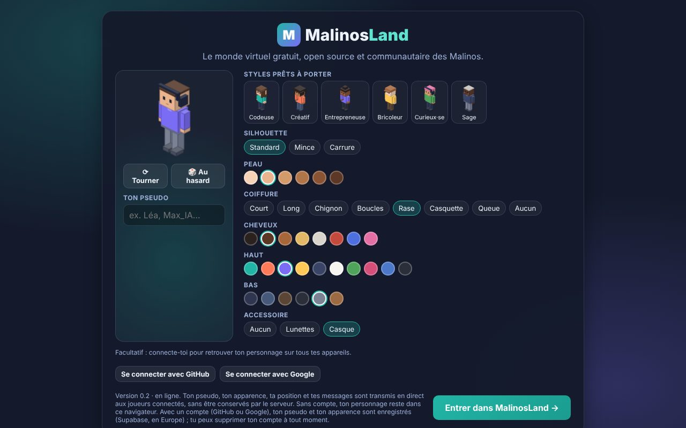

# Comptes joueurs (Supabase)

> **En bref (version simple)** : les comptes sont **facultatifs**. Sans compte, on joue en
> visiteur comme avant : le personnage est enregistré dans le navigateur. Avec un compte **GitHub**
> ou **Google**, on retrouve son personnage sur tous ses appareils, son pseudo est réservé, et une
> marque **✓** à côté du nom prouve aux autres que c’est bien lui. Les comptes sont gérés par
> **Supabase** (offre gratuite, serveurs à Paris). Pas de connexion par e-mail : l’envoi d’e-mails
> n’est pas gratuit à grande échelle.



## 1. Ce qui est en place

| Élément                     | Où                                                                    |
| --------------------------- | --------------------------------------------------------------------- |
| Projet Supabase             | `malinosland` (région Paris, offre gratuite), créé le 19/10/2026      |
| Table des profils et règles | `supabase/migrations/` (testé par `tests/database.test.ts`)           |
| Connexion dans le jeu       | `src/services/account.ts`, `src/ui/AccountBox.tsx`                    |
| Vérification par le serveur | `server/src/account.ts` (fonction `my_profile` de la base)            |
| Base gardée active          | workflow GitHub « Maintien de la base des comptes » (1 fois par jour) |

### Ce qui est enregistré

- **Par Supabase Auth** : l’identifiant du compte GitHub ou Google et l’adresse e-mail que ce
  service fournit (nécessaire à la connexion ; jamais affichée dans le jeu).
- **Dans la table `profiles`** : le pseudo (unique) et l’apparence de l’avatar. Rien d’autre.
- Les positions et messages du chat ne sont **jamais** enregistrés.

### Les règles (vérifiées par la base, pas par l’interface)

- Tout le monde peut **lire** les profils (pseudo et apparence sont visibles dans le jeu).
- Chacun ne peut **créer et modifier que son propre** profil, et seulement le pseudo et
  l’apparence.
- Pseudo **unique** (sans tenir compte des majuscules), 2 à 20 caractères.
- **Supprimer son compte** (Réglages → Compte) efface le compte et le profil, définitivement.

### Comment le serveur temps réel reconnaît un compte

1. Le jeu envoie son **jeton de connexion** en ouvrant la WebSocket (dans les sous-protocoles,
   jamais dans l’adresse).
2. Le Worker demande à la base « à qui appartient ce jeton ? » (`my_profile`). C’est la base qui
   vérifie la signature : **le serveur n’a aucun secret**.
3. Si le jeton est bon, le joueur garde l’**identifiant et le pseudo de son compte** et reçoit la
   marque ✓. Sinon, il joue en visiteur. Un visiteur ne peut pas prendre l’identifiant d’un compte.

## 2. À faire par le responsable (une seule fois)

Ces réglages se font dans les tableaux de bord : ils contiennent des **secrets** (« Client
secret ») qui ne doivent jamais aller dans le dépôt ni dans une conversation avec une IA.

### Étape 1 — Fonction de suppression de compte

Dans Supabase → projet **malinosland** → **SQL Editor** → **New query**, coller puis **Run** :

```sql
create or replace function public.delete_my_account()
returns void
language plpgsql
security definer
set search_path = ''
as $$
begin
  if (select auth.uid()) is null then
    raise exception 'Connexion requise';
  end if;
  delete from auth.users where id = (select auth.uid());
end;
$$;

revoke execute on function public.delete_my_account() from public, anon;
grant execute on function public.delete_my_account() to authenticated;
```

(Elle n’efface que le compte **de la personne connectée** qui la demande.)

### Étape 2 — Adresses autorisées

Supabase → **Authentication** → **URL Configuration** :

- **Site URL** : `https://malinosland.pages.dev`
- **Redirect URLs** : ajouter `https://malinosland.pages.dev/**` et `http://localhost:5173/**`

### Étape 3 — Connexion avec GitHub

1. Sur GitHub : **Settings** (de ton profil) → **Developer settings** → **OAuth Apps** →
   **New OAuth App**.
   - Application name : `MalinosLand`
   - Homepage URL : `https://malinosland.pages.dev`
   - Authorization callback URL : `https://xezisaqffltiuyeblknt.supabase.co/auth/v1/callback`
2. **Register application**, puis **Generate a new client secret**. Copier le **Client ID** et le
   **Client secret**.
3. Supabase → **Authentication** → **Sign In / Providers** → **GitHub** : activer, coller le Client
   ID et le Client secret, **Save**.

### Étape 4 — Connexion avec Google

1. [console.cloud.google.com](https://console.cloud.google.com) → créer un projet « MalinosLand »
   (gratuit, aucune carte demandée pour cet usage).
2. **APIs & Services** → **OAuth consent screen** (ou « Google Auth Platform ») : type
   **External**, nom de l’application `MalinosLand`, e-mail de contact ; domaine autorisé
   `supabase.co`. Publier l’application (« In production ») pour que tout le monde puisse se
   connecter.
3. **Credentials** → **Create credentials** → **OAuth client ID** → type **Web application** :
   - Authorized JavaScript origins : `https://malinosland.pages.dev`
   - Authorized redirect URIs : `https://xezisaqffltiuyeblknt.supabase.co/auth/v1/callback`
4. Copier le **Client ID** et le **Client secret** dans Supabase → **Sign In / Providers** →
   **Google** → activer → **Save**.

### Étape 5 — Désactiver la connexion par e-mail

Supabase → **Sign In / Providers** → **Email** : désactiver. Le jeu ne la propose pas, et l’envoi
d’e-mails gratuit de Supabase est réservé aux membres de l’équipe du projet.

### Étape 6 — Mettre en ligne

GitHub → **Actions** → **Mise en ligne** → **Run workflow**. Les boutons « Se connecter avec
GitHub / Google » apparaissent alors dans le jeu.

## 3. Gratuité et limites

- Offre gratuite Supabase : 50 000 utilisateurs actifs par mois, base de 500 Mo — très
  au-dessus des besoins (un profil ≈ 0,5 Ko).
- Un compte gratuit Supabase a **2 projets actifs au maximum** (projets en pause non comptés) :
  le projet LaChillance a été mis en pause le 19/10/2026 pour faire de la place. Il peut être
  relancé depuis le tableau de bord pendant 90 jours (il faudrait alors en mettre un autre en
  pause).
- Un projet gratuit est mis **en pause après 7 jours sans activité** : le workflow quotidien
  « Maintien de la base des comptes » l’évite. Si la base est en pause malgré tout, le jeu reste
  jouable en visiteur ; on la relance avec **Resume project** dans Supabase.

## 4. Tester sans compte

- `npm test` : les règles de la base (`tests/database.test.ts`) tournent dans un vrai PostgreSQL
  en WebAssembly (PGlite), avec une imitation minimale de Supabase.
- `npm --prefix server run test:integration` : le serveur temps réel vérifie un compte auprès
  d’une fausse base locale.
- En local, sans `VITE_SUPABASE_URL`, le jeu fonctionne sans comptes.
