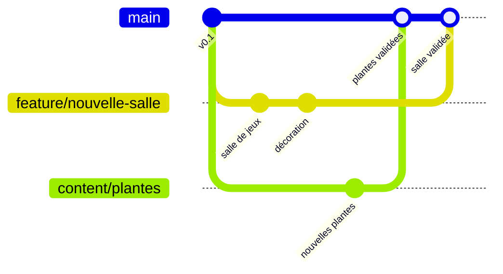

# Contribuer à MalinosLand

Merci de vouloir aider ! MalinosLand est construit **par la communauté**. Tu n’as pas besoin d’être
développeur pour participer. Si un mot te semble obscur, regarde le [glossaire](GLOSSAIRE.md).

## 1. Le principe en 30 secondes

La version officielle du jeu est sur la branche **`main`**. Elle est **protégée** : personne ne la
modifie directement. Chacun travaille sur **sa propre branche**, puis demande à ajouter ses
changements avec une **pull request**. Le responsable du projet relit, puis valide.



_Plusieurs contributions avancent en parallèle sans se gêner, puis sont ajoutées à `main` une fois
relues et validées._

## 2. Sans programmer : comment aider

| Je veux…                               | Comment faire                                                                                                                                                              |
| -------------------------------------- | -------------------------------------------------------------------------------------------------------------------------------------------------------------------------- |
| Le dire depuis le jeu, sans compte     | Dans le hall : la **Boîte à idées** 💡 et la **Borne à bugs** 🐞 (ou le bouton 💡 en haut de l’écran). L’équipe relit et transforme les messages utiles en tickets GitHub. |
| Signaler un bug                        | [Ouvrir une issue « Bug »](https://github.com/Rogue06/MalinosLand/issues/new/choose) : ce que tu faisais, ce qui s’est passé, ton navigateur, une capture d’écran.         |
| Proposer une idée                      | [Ouvrir une issue « Idée »](https://github.com/Rogue06/MalinosLand/issues/new/choose).                                                                                     |
| Proposer un objet, une déco, une salle | [Ouvrir une issue « Contenu »](https://github.com/Rogue06/MalinosLand/issues/new/choose) avec une description et, si possible, un croquis.                                 |
| Soutenir une idée                      | Ajouter une réaction 👍 sur l’issue.                                                                                                                                       |
| Tester sur ton ordinateur              | Suivre [Essayer le jeu](../README.md#essayer-le-jeu) et partager tes impressions (fluidité, bugs).                                                                         |

### Modifier un texte directement sur GitHub (sans rien installer)

Pour corriger une faute ou ajouter une astuce IA :

1. Ouvre le fichier sur GitHub (par exemple `src/content/tips.ts` pour les astuces).
2. Clique sur le crayon ✏️ (« Edit this file »). GitHub crée automatiquement ta copie (fork).
3. Fais ta modification, puis clique sur **Commit changes…** et choisis
   **« Create a new branch… and start a pull request »**.
4. Décris ton changement, puis clique sur **Create pull request**. C’est tout !

## 3. Avec du code : la méthode pas à pas

```bash
# 1. Récupérer le projet (sur ton fork si tu n'as pas les droits d'écriture)
git clone https://github.com/<ton-compte>/MalinosLand.git
cd MalinosLand
npm install

# 2. Créer ta branche à partir de main à jour
git checkout main
git pull
git checkout -b feature/ma-fonctionnalite

# 3. Développer et regarder le résultat
npm run dev                 # http://localhost:5173

# 4. Vérifier que tout est correct (types, style, tests, compilation)
npm run check

# 5. Enregistrer et envoyer
git add -A
git commit -m "feat: ajoute la salle de jeux"
git push -u origin feature/ma-fonctionnalite
```

6. Sur GitHub, ouvre une **pull request vers `main`** et remplis le modèle (il te guide).
7. Les vérifications automatiques se lancent. Réponds aux remarques de la relecture.
8. Le responsable du projet valide et fusionne. 🎉

### Nommer sa branche

| Préfixe    | Pour quoi                                 | Exemple                    |
| ---------- | ----------------------------------------- | -------------------------- |
| `feature/` | Nouvelle fonctionnalité ou nouvelle salle | `feature/minigame-quiz`    |
| `fix/`     | Correction de bug                         | `fix/collision-ascenseur`  |
| `content/` | Objets, décors, textes, cartes            | `content/decorations-noel` |
| `docs/`    | Documentation                             | `docs/guide-graphismes`    |

### Écrire un message de commit

Format court en français : `type: ce que fait le changement`.
Types : `feat` (nouveauté), `fix` (correction), `docs` (documentation), `refactor`
(réorganisation), `test` (tests), `chore` (entretien).

## 4. Recettes courantes

### Ajouter un objet (meuble, décoration)

1. **Le décrire** dans `src/content/catalog.ts` : nom, taille au sol, s’il bloque le passage, places
   assises, interaction, lumière.
2. **Le dessiner** dans `src/game/art/objects.ts` avec des boîtes (`IsoBuilder`), l’objet tourné
   vers le bas-gauche de l’écran.
3. **Le vérifier** : `npm run dev` puis http://localhost:5173/art-preview.html (les 4 rotations).
4. **Le placer** dans une carte (`src/content/maps/hub.json`) et lancer `npm test`.

### Ajouter ou modifier une salle

Le format des cartes est expliqué dans [WORLD_DESIGN.md](WORLD_DESIGN.md). Les tests refusent
automatiquement une carte cassée ou un objet inaccessible : pas de risque de tout casser.

### Ajouter une astuce IA

Une phrase de plus dans `src/content/tips.ts`. Courte, utile, bienveillante.

### Mettre à jour les captures de la documentation

```bash
npm run build && npm run preview      # dans un premier terminal
npm run docs:screenshots              # dans un second terminal → docs/images/
```

### Jouer à plusieurs avec le serveur temps réel (sur ton ordinateur)

Pas besoin de compte Cloudflare : le serveur tourne en local avec Wrangler.

```bash
npm run server:install                # une seule fois (outils du serveur, dossier server/)
npm run server:dev                    # premier terminal : serveur sur ws://localhost:8787/ws
cp .env.example .env.local            # une seule fois (sous Windows : copy .env.example .env.local)
npm run dev                           # second terminal : le jeu se connecte au serveur
```

Ouvre ensuite le jeu dans deux navigateurs différents (ou une fenêtre privée) : les deux avatars
se voient. Le badge « En ligne » apparaît en haut de l’écran. Détails :
[REALTIME_NETWORK.md](REALTIME_NETWORK.md).

## 5. Ce qu’on attend d’une contribution

- ✅ `npm run check` passe.
- ✅ Testé dans le navigateur.
- ✅ **Aucun service payant**, aucune nouvelle dépendance sans explication.
- ✅ Aucun mot de passe, clé ou donnée personnelle dans le code.
- ✅ Une fonctionnalité pas terminée est affichée « bientôt », jamais présentée comme finie.
- ✅ Documentation et [CHANGELOG](CHANGELOG.md) mis à jour si besoin.
- ✅ Graphismes originaux (pas de copie d’un autre jeu), ressources externes sous licence libre
  et créditées.

Côté code : TypeScript strict ; logique dans `src/core/` ou `src/world/` (testée), affichage dans
`src/game/`, interface dans `src/ui/`. Textes et commentaires en français, noms de variables en
anglais. Détails dans [ARCHITECTURE.md](ARCHITECTURE.md).

## 6. Éviter les conflits entre contributeurs

Le projet est découpé pour que plusieurs personnes avancent en même temps :

- un **objet** = une entrée dans le catalogue + une fonction de dessin ;
- une **salle** = de préférence sa propre carte JSON ;
- un **mini-jeu** (v0.5) = un module indépendant ;
- les **textes** (astuces, dialogues) sont dans `src/content/`.

## 7. Développer avec une IA

Les assistants IA (Claude Code, Codex, Cursor, Copilot…) sont bienvenus. Ils lisent
automatiquement [`AGENTS.md`](../AGENTS.md) et doivent lire [SESSION_HANDOFF.md](SESSION_HANDOFF.md).
Mode d’emploi : [Reprendre le projet](REPRENDRE_LE_PROJET.md). Relis toujours le code proposé et vérifie que
`npm run check` passe vraiment.

## 8. Sécurité et respect

- Une faille de sécurité se signale **en privé** : voir [SECURITY.md](SECURITY.md).
- Merci de respecter le [code de conduite](../CODE_OF_CONDUCT.md) : bienveillance avant tout.
