# Guide du joueur

Bienvenue dans MalinosLand ! Pour jouer, ouvre **[malinosland.pages.dev](https://malinosland.pages.dev)** : rien à installer.

> Rappel : c’est encore un **prototype** (v0.2 en cours). Il n’y a pas encore de compte : ton
> personnage est enregistré **dans ton navigateur**. En ligne, ton pseudo, ton apparence, ta
> position et tes messages sont transmis en direct aux autres joueurs connectés (le serveur ne les
> conserve pas). Le badge « En ligne » en haut de l’écran indique que tu es connecté.

## 1. Créer son personnage

- Choisis un **style prêt à porter**, ou règle toi-même la silhouette, la peau, la coiffure, les
  couleurs et un accessoire (lunettes ou casque).
- **Tourner** fait pivoter l’aperçu ; **Au hasard** tire un style surprise.
- Choisis un **pseudo** (2 à 20 caractères), puis clique sur **Entrer dans MalinosLand**.

Tu pourras tout changer plus tard grâce au **miroir** du salon ou au bouton 🧑 en haut à droite.

### Avec ou sans compte ?

Les deux marchent. **Sans compte**, ton personnage est enregistré dans ce navigateur.
**Avec un compte** (boutons « Se connecter avec GitHub / Google ») :

- tu retrouves ton personnage sur tous tes appareils ;
- ton pseudo t’est réservé, et une marque **✓** à côté de ton nom montre aux autres que c’est
  bien toi ;
- tu peux te déconnecter ou **supprimer ton compte** à tout moment (⚙️ Réglages → Compte).

Ce qui est enregistré : ton pseudo et ton apparence. Jamais tes messages ni tes déplacements.

## 2. Se déplacer et interagir

| Je veux…            | À la souris                                      | Au clavier                                                    |
| ------------------- | ------------------------------------------------ | ------------------------------------------------------------- |
| Me déplacer         | Je clique sur le sol                             | **Z Q S D** (AZERTY), **W A S D** (QWERTY) ou les **flèches** |
| Utiliser un objet   | Je clique dessus : mon personnage y va tout seul | Je m’approche et j’appuie sur **E** (ou **Espace**)           |
| M’asseoir           | Je clique sur une chaise, un canapé, un banc     | **E** à côté du siège                                         |
| Me lever            | —                                                | **E**, ou je me déplace                                       |
| Zoomer              | Molette de la souris                             | —                                                             |
| Écrire dans le chat | Je clique dans le champ du chat                  | **Entrée**, j’écris, **Entrée** pour envoyer                  |
| Fermer une fenêtre  | Clic à côté, ou ✕                                | **Échap**                                                     |

Quand tu es près d’un objet utilisable, un bouton apparaît en bas de l’écran
(par exemple **E · Parler à Joshua**) : appuie sur **E** ou clique dessus. Les objets utilisables
s’éclairent au survol de la souris.

### Sur téléphone ou tablette

- **Se déplacer** : touche le sol.
- **Utiliser un objet, s’asseoir** : touche l’objet. Tout près, le bouton **👆** en bas de l’écran
  fait la même chose (et **👆 Se lever** pour te relever).
- **Zoomer** : écarte ou rapproche deux doigts.
- **Chat** : il est replié sur une ligne (dernier message + nombre de messages non lus, en jaune si
  on t’a mentionné). Touche cette ligne pour le déplier, **▾** pour le replier. Tu peux écrire
  directement sans le déplier.
- Le jeu marche aussi en paysage : le chat passe à droite, les boutons à gauche.

## 3. L’écran de jeu

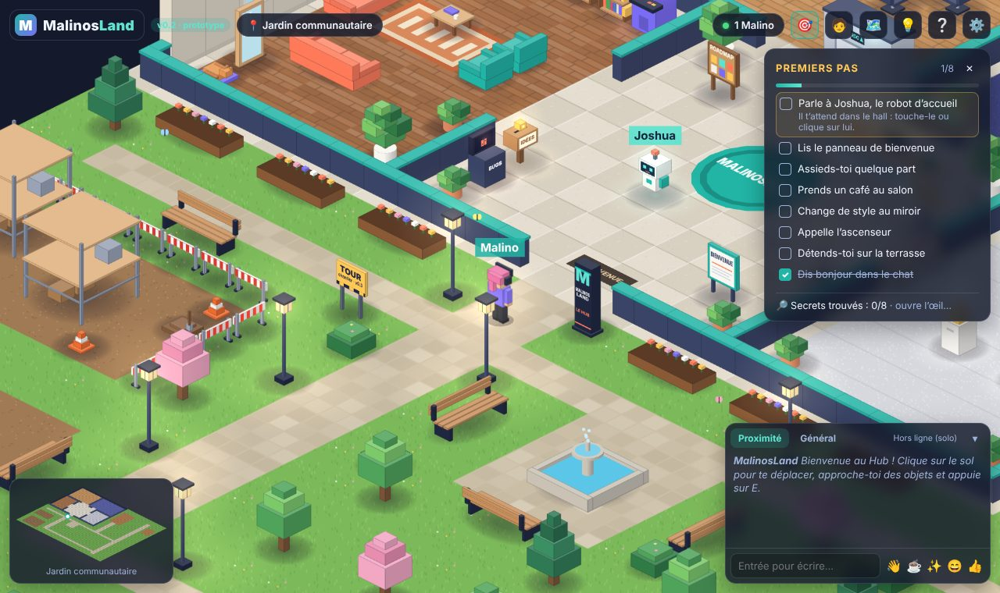

- **En haut à gauche** : le nom du lieu où tu te trouves.
- **En haut à droite** : le nombre de Malinos présents et les boutons 🎯 objectifs, 🧑 avatar,
  🗺️ feuille de route, ❔ aide, ⚙️ réglages.
- **À droite** : tes objectifs « Premiers pas ».
- **En bas à gauche** : la mini-carte (toi = point blanc).
- **En bas à droite** : le chat et les émotes 👋 ☕ ✨ 😄 👍.

### Le chat : à qui j’écris ?

Tous les messages arrivent dans le même fil. Au-dessus, **« À : »** indique qui te lira :

- **🌍 Tout le monde** (choix par défaut) : tous les Malinos connectés ;
- **📍 Autour** : seulement les Malinos à moins de **8 cases** de toi (environ la largeur du hall
  d’accueil), avec une bulle au-dessus de ta tête. Le nombre à côté indique combien de Malinos
  te liront. Ces messages sont marqués 📍 dans le fil.

## 4. Visite du Hub

### Le hall d’accueil

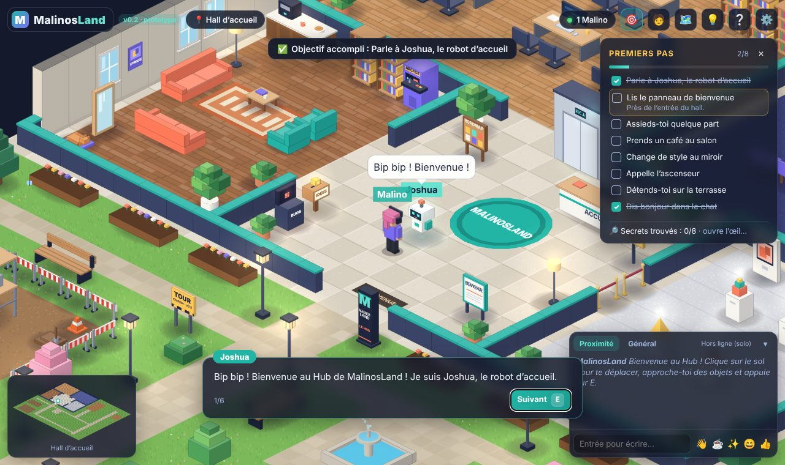

Le cœur du Hub. **Joshua**, le robot d’accueil, t’explique les bases. Tu y trouves aussi le panneau
de bienvenue, le tableau de la feuille de route et l’**ascenseur**.

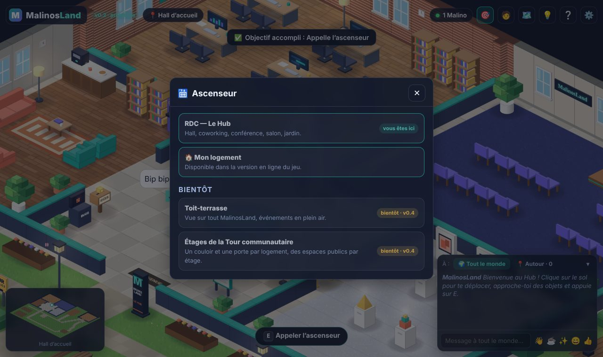

L’ascenseur montre les étages prévus. Seul le rez-de-chaussée existe pour l’instant : la tour des
logements et le toit-terrasse sont marqués **« bientôt »**.

### L’espace coworking

Des bureaux pour travailler ensemble. Un des ordinateurs affiche **l’astuce IA du jour**.

### La salle de conférence et la galerie

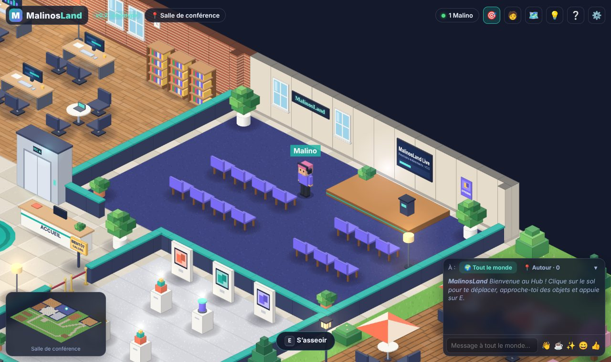

La **salle de conférence** (scène, écran géant, sièges) accueillera des événements à partir de la
v0.5. Juste devant, la **Galerie des Malinos** est encore fermée par une corde : elle ouvrira en
v0.4 pour exposer les projets de la communauté.

### Le salon détente

Canapés, fauteuils, **comptoir à café**, borne d’arcade (les mini-jeux arrivent en v0.5) et le
**miroir** pour changer de style.

### Le jardin et la terrasse

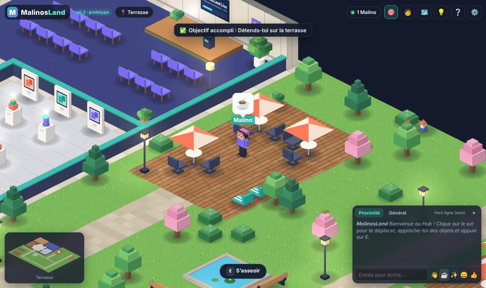

Autour du bâtiment : fontaine, bancs, jardinières, et une terrasse avec tables à parasol et
transats. À gauche, le **chantier de la Tour communautaire** annonce les étages à venir (v0.4).

### Le Parc des Malinos et le verger

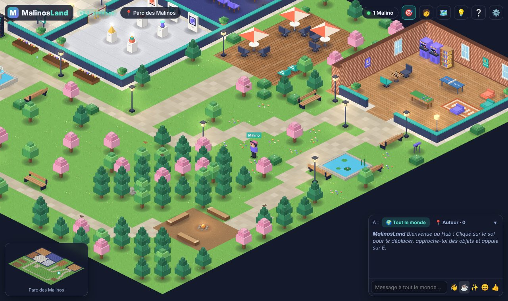

À l’est, le **Parc des Malinos** : des chemins qui serpentent dans une prairie fleurie, un étang
avec ses nénuphars et ses bancs, un télescope, et beaucoup d’arbres où se posent les oiseaux
(approche-toi : ils s’envolent !). Au sud-est, la **Forêt des Malinos** cache une clairière avec
un feu de camp et des rondins pour s’asseoir. Au sud, la **promenade du verger** longe les arbres
fruitiers jusqu’au **potager partagé**.

### La salle de jeux

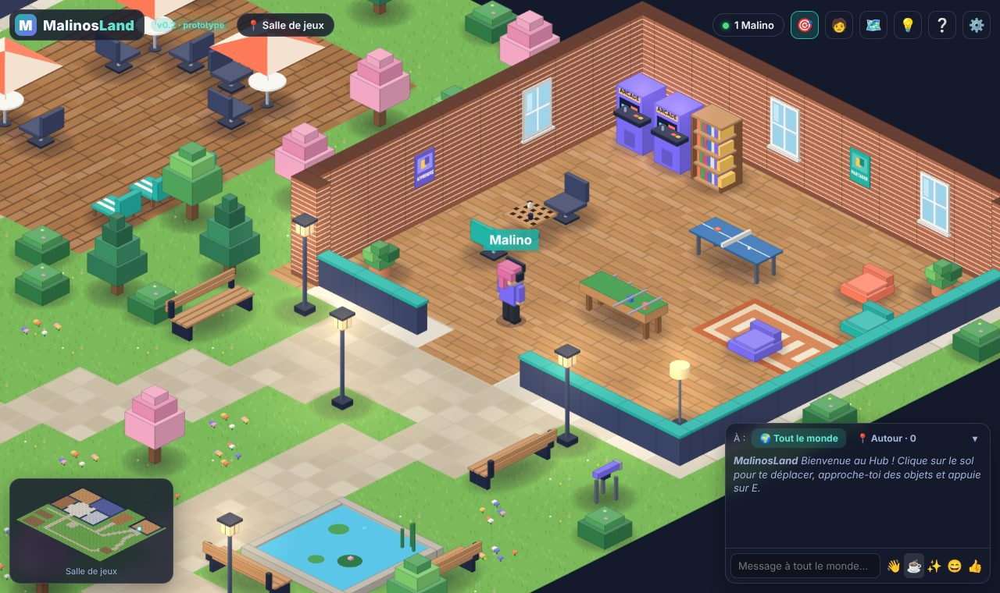

Au nord du parc : deux bornes d’arcade, une table de ping-pong, un baby-foot, une table d’échecs,
des poufs et des jeux de société. Pour l’instant on y joue « pour de faux » : les vrais
**mini-jeux à plusieurs** arrivent avec la v0.5.

## 5. Les objectifs « Premiers pas »

Huit petites missions pour découvrir le Hub : parler à Joshua, lire le panneau de bienvenue, s’asseoir,
prendre un café, changer de style au miroir, appeler l’ascenseur, aller sur la terrasse et dire
bonjour dans le chat. Il n’y a **rien à gagner** : c’est juste pour bien démarrer. 🙂

### Des secrets ?

Le Hub cache **10 secrets**. Sous tes objectifs, ouvre le **📓 Carnet de Joshua** : pour chaque
secret pas encore trouvé, Joshua laisse une **devinette** ; chaque secret découvert révèle une
**page de son carnet** (et quand tout est trouvé… une dernière page un peu mystérieuse).
Avec un compte, tes objectifs et tes secrets te suivent sur tous tes appareils.

## 6. Changer de style

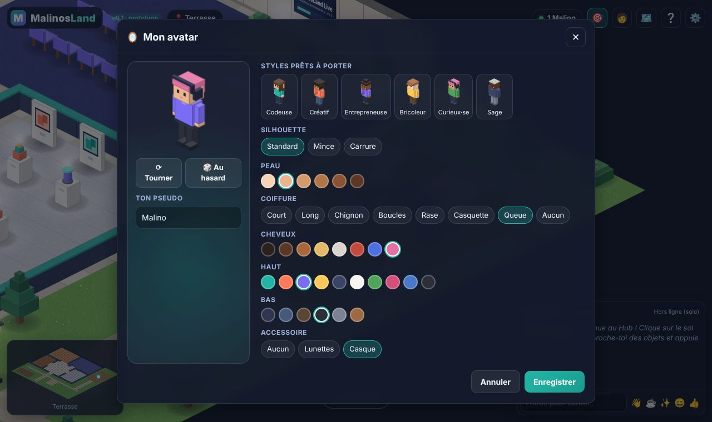

Bouton 🧑 en haut à droite, ou le miroir du salon. N’oublie pas de cliquer sur **Enregistrer**.

## 7. La feuille de route dans le jeu

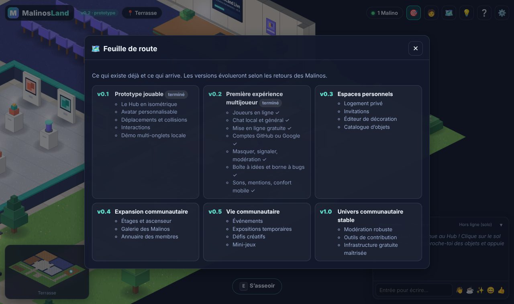

Bouton 🗺️ : les prochaines versions résumées. Détails dans [ROADMAP.md](ROADMAP.md).

## 8. Réglages (⚙️)

| Réglage                       | À quoi ça sert                                                                                                                                             |
| ----------------------------- | ---------------------------------------------------------------------------------------------------------------------------------------------------------- |
| **Qualité graphique**         | _Basse_ pour les ordinateurs modestes (pas d’ombres ni de halos), _Normale_ recommandée, _Haute_ pour les écrans très fins. S’applique après rechargement. |
| **Images par seconde max.**   | 30 pour économiser la batterie, 60 par défaut.                                                                                                             |
| **Réduire les animations**    | Pour un affichage plus calme.                                                                                                                              |
| **Afficher les noms**         | Montre ou cache les pseudos au-dessus des têtes.                                                                                                           |
| **Sons**                      | Petit son à l’arrivée d’un message et quand on te mentionne (@pseudo).                                                                                     |
| **Ambiance sonore**           | Oiseaux et vent dehors, claviers au coworking, ascenseur dans le hall, cheminée au salon.                                                                  |
| **Volume**                    | Volume de tous les sons du jeu.                                                                                                                            |
| **Afficher les performances** | Montre les images par seconde (utile pour signaler un souci).                                                                                              |
| **Compte**                    | Se connecter avec GitHub ou Google, se déconnecter, supprimer son compte.                                                                                  |
| **Démo multijoueur locale**   | Relie les onglets ouverts dans ce même navigateur (version hors ligne seulement).                                                                          |

### Sons, mentions et statut « absent »

- Un petit **« pop »** signale un nouveau message. Si quelqu’un envoie trop de messages d’affilée,
  il ne fait plus de bruit pendant une minute (le chat reste lisible).
- Écris **@pseudo** pour appeler quelqu’un : son message est surligné en jaune chez lui, avec un
  petit carillon. Si son onglet est caché, le titre de l’onglet affiche le nombre de mentions.
- Tu passes sur un autre onglet plus de 20 secondes ? Les autres voient ton avatar pâle avec 💤
  (**absent**). Tout redevient normal dès ton retour.
- Le navigateur n’autorise le son qu’après ton premier clic ou ta première touche.

### Le Hub est plein ?

Une salle accueille 40 Malinos à la fois. Si elle est pleine, tu passes dans la **file
d’attente** : ta place s’affiche (« tu es 3e »), tu explores en solo en attendant, et tu entres
tout seul dès qu’une place se libère.

## 9. Ton logement (v0.3)

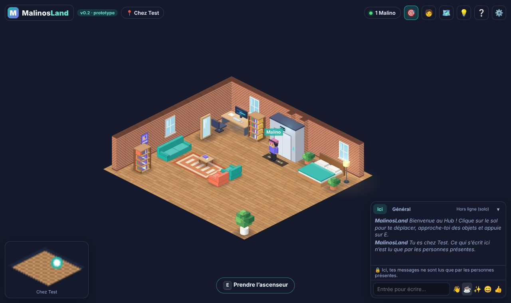

Avec un compte (GitHub ou Google), tu as ton **studio** dans la Tour des Malinos.

- **Y aller** : prends l’ascenseur du hall → **🏠 Mon logement**. Pour revenir : l’ascenseur du
  studio → **RDC — Le Hub** (tu arrives devant l’ascenseur du hall).
- **Qui peut entrer ?** Touche la **table basse** du studio : **🔒 Personne**, **✉️ Sur
  invitation** ou **🚪 Tout le monde** (même sans compte). C’est le serveur et la base de données
  qui vérifient, pas seulement le jeu : impossible de forcer la porte.
- **Inviter** : bouton « N Malinos » en haut de l’écran → **Inviter** à côté d’un joueur connecté
  à son compte (✓). Retirer une invitation, ou fermer ton logement, raccompagne aussitôt la
  personne à l’ascenseur si elle est chez toi.
- **Visiter** : l’ascenseur liste les logements ouverts à tous et ceux où tu es invité.
- **Discussion privée** : dans un logement, ce que tu écris n’est lu que par les personnes
  présentes (même un message « tout le monde »). Les messages du Hub, eux, continuent d’arriver.
- 12 personnes au plus par logement.

### Décorer son logement

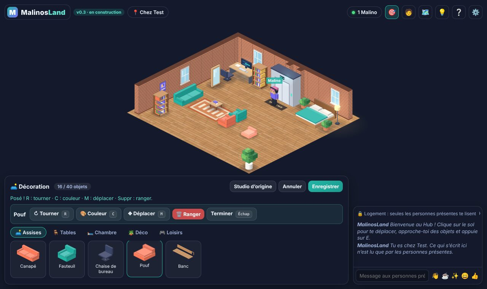

Chez toi, touche le bouton **🛋️** en haut de l’écran (ou la table basse → **Décorer mon
logement**). Une barre s’ouvre en bas avec le **catalogue de meubles** (assises, tables, chambre,
déco, loisirs : 21 objets).

- **Ajouter** : choisis un meuble, puis clique sur le sol. Au doigt : touche une première fois
  pour viser, une deuxième fois pour poser. L’empreinte au sol est **verte** si c’est possible,
  **rouge** sinon (avec l’explication).
- **Modifier** : touche un meuble posé (contour jaune), puis **↻ Tourner** (R), **🎨 Couleur**
  (C), **✥ Déplacer** (M) ou **🗑️ Ranger** (Suppr).
- **Enregistrer** garde ta décoration ; **Annuler** remet tout comme avant ; **Studio
  d’origine** remet les meubles de départ.
- Quelques règles pour que tout le monde puisse circuler : l’entrée et l’ascenseur restent
  dégagés, il reste toujours un passage vers chaque meuble, et 40 objets au plus.
- Les personnes présentes voient la nouvelle décoration dès que tu enregistres.

## 10. Quelqu’un te dérange ?

Clique sur **« N Malinos »** en haut de l’écran : la liste des joueurs connectés s’ouvre.

- **Masquer** : tu ne vois plus son avatar, ses messages ni ses bulles. Lui ne le sait pas. Tu peux
  revenir en arrière avec « Afficher ».
- **Signaler** (compte nécessaire) : choisis un motif, ajoute des précisions si tu veux. Ses
  derniers messages sont joints automatiquement. L’équipe de modération regarde chaque signalement.

## 11. Une idée ? Un bug ?

Dans le hall, près de l’entrée, la **Boîte à idées** 💡 et la **Borne à bugs** 🐞 t’attendent
(aussi accessibles avec le bouton 💡 en haut de l’écran). Écris ton message, il arrive directement
à l’équipe, même sans compte. Les meilleures idées deviennent des tâches pour les contributeurs.

Tu as un compte GitHub ? Tu peux aussi ouvrir une
[issue](https://github.com/Rogue06/MalinosLand/issues/new/choose) et en discuter avec eux.
