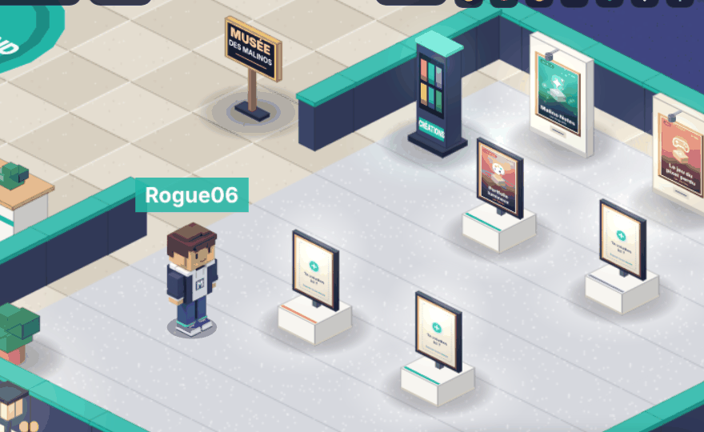
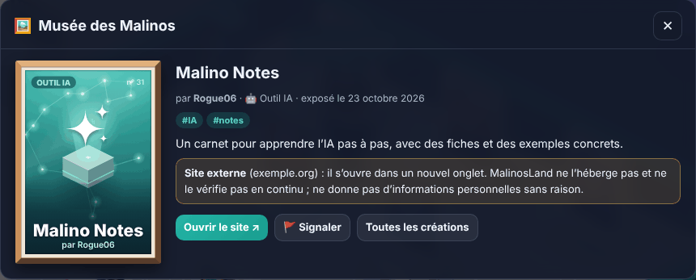
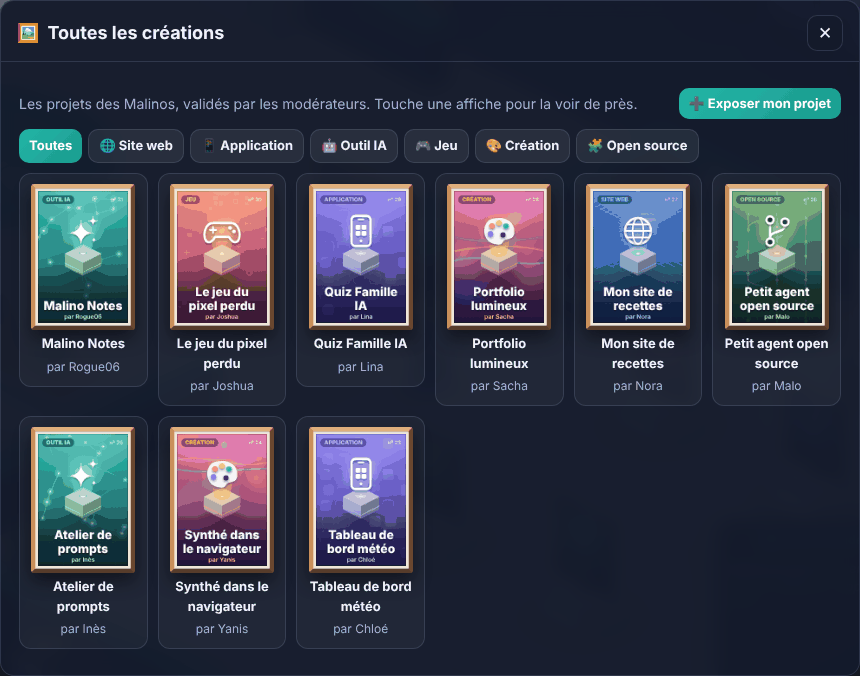
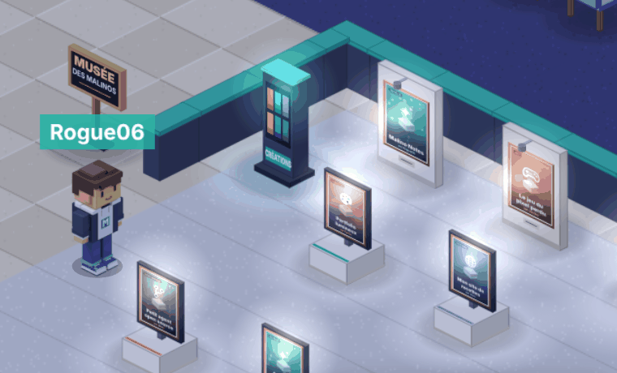
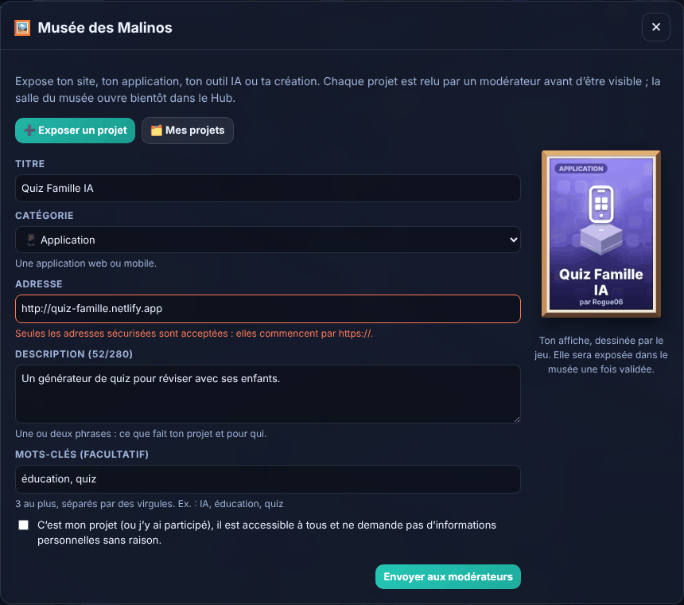
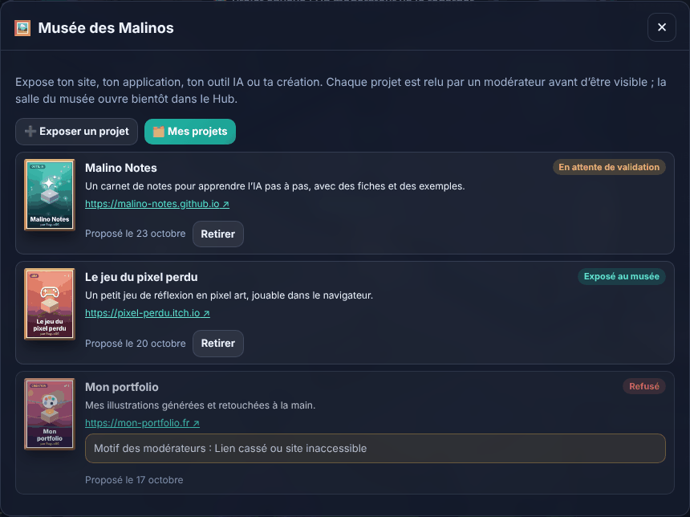
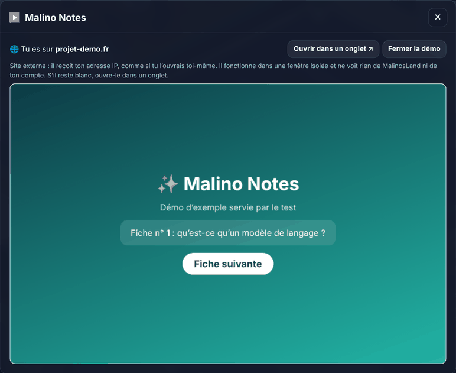
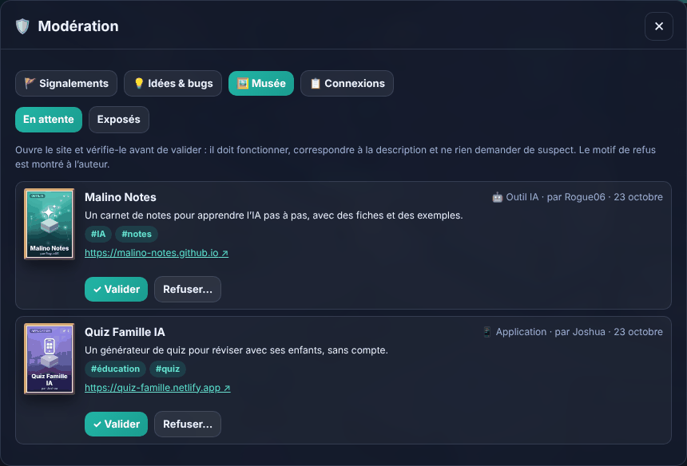
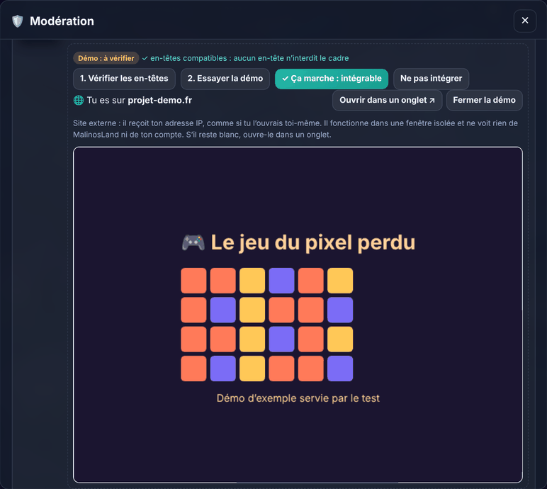
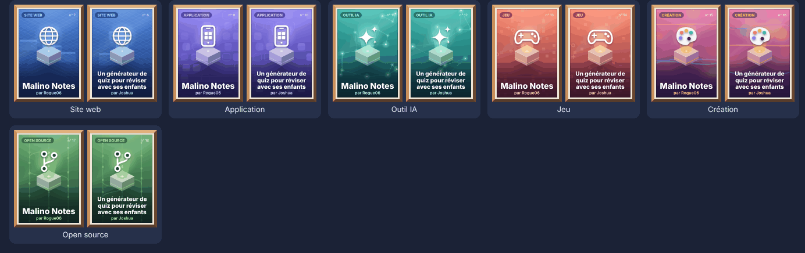

# Musée des Malinos

> **En bref.** Chaque membre connecté peut proposer un projet (site, application, outil IA, jeu,
> création, dépôt open source). Le projet reste **en attente** jusqu’à ce qu’un **modérateur** le
> valide ; il est ensuite exposé à tous. L’auteur peut le retirer quand il veut. Le jeu dessine
> lui-même l’**affiche** de chaque projet : aucune image n’est envoyée ni stockée.
>
> État (v0.4 en cours) : la base (PR 7), le formulaire avec la modération (PR 8), la **salle**
> (PR 9 : stands, borne « Toutes les créations », fiche, signalements) et la démo **« Essayer
> ici »** (PR 10) sont faits. Reste le Bâtiment des créations (PR 11). Voir
> [PLAN_EVOLUTION.md](PLAN_EVOLUTION.md).

## Visiter le musée

L’ancienne galerie, à droite du hall d’accueil, est devenue le **Musée des Malinos**. Ses
**7 stands** (3 cimaises au mur, 4 présentoirs sur socle) portent les affiches des projets les
plus récents ; un stand encore libre montre une invitation « Ta création ici ? ».

- **Clique sur un stand** pour ouvrir la **fiche** du projet : affiche, auteur, catégorie,
  mots-clés, description et le bouton **Ouvrir le site** (nouvel onglet, avec un avertissement
  « site externe »). Un stand libre ouvre le formulaire pour exposer son projet.
- La borne **« Toutes les créations »** liste tous les projets exposés, filtrés par catégorie,
  par pages de 20.
- **🚩 Signaler** (compte nécessaire) : lien cassé, contenu choquant, arnaque, droits d’auteur ou
  autre. Le signalement va aux modérateurs, et la démo intégrée repasse « à vérifier ».
- Le soir, les projecteurs du musée éclairent les affiches.

La liste des stands est lue **une seule fois** quand on approche (hall ou musée), puis gardée
5 minutes : une petite requête par visite, sans coût. _Captures faites avec des projets
d’exemple._

## Pour les membres : exposer un projet

On ouvre le formulaire depuis le **panneau devant la galerie**, dans le Hub (« Exposer mon projet
au musée »), ou depuis ⚙️ Réglages → **🖼️ Mes projets** quand on est connecté.

- **Titre** (60 caractères au plus), **catégorie**, **adresse**, **description** (une ou deux
  phrases, 280 caractères au plus) et jusqu’à **3 mots-clés**.
- L’adresse doit être **publique et sécurisée** (`https://`). Si on oublie `https://`, le jeu
  l’ajoute. Sont refusées : les adresses `http://`, les adresses IP, les numéros de port, les
  identifiants dans l’adresse, les adresses locales et celles de MalinosLand. Le message dit
  quoi corriger.
- L’**aperçu** à droite montre l’affiche qui sera exposée ; il change pendant qu’on écrit.
- Une case à cocher confirme que c’est son projet (ou qu’on y a participé) et qu’il ne demande
  pas d’informations personnelles sans raison.
- Limites anti-abus (vérifiées par la base) : 5 propositions par jour, 3 projets en attente et
  10 projets exposés au plus par membre.

L’onglet **Mes projets** montre le statut de chacun (en attente, exposé, refusé, retiré), le
**motif** laissé par le modérateur en cas de refus, et un bouton **Retirer**.

_Captures faites avec des données d’exemple._

## Essayer une démo sans quitter le jeu

Quand un modérateur l’a validé, un projet affiche **▶ Essayer ici** sur sa fiche : le site
s’ouvre dans une fenêtre du jeu, **seulement après ce clic**.

- L’adresse du site est écrite en clair (« Tu es sur … ») et **Ouvrir dans un onglet** reste
  toujours visible.
- Le site est **isolé** : il ne peut ni changer la page du jeu, ni ouvrir de fenêtres, ni
  télécharger, ni utiliser la caméra, le micro, la position ou le plein écran. Il ne sait pas
  qu’il est affiché dans MalinosLand et ne voit ni le jeu ni ton compte.
- Comme tout site que tu ouvres, il reçoit ton **adresse IP** : c’est écrit au-dessus du cadre.
- Beaucoup de sites refusent d’être affichés dans un cadre : ils gardent simplement « Ouvrir le
  site ». **MalinosLand ne contourne jamais ce refus** (pas de copie, pas d’intermédiaire).

**Ce qui reste possible, honnêtement** : un site validé peut changer plus tard. D’où l’adresse
affichée, le bouton 🚩 Signaler (qui remet la démo « à vérifier ») et le retrait par les
modérateurs.

## Pour les modérateurs

Panneau 🛡️ **Modération** → onglet **🖼️ Musée** :

- **En attente** : les projets proposés, du plus ancien au plus récent. **Ouvrir le site** (nouvel
  onglet) et le vérifier avant de valider : il doit fonctionner, correspondre à la description et
  ne rien demander de suspect.
- **✓ Valider** expose le projet. **Refuser…** propose des motifs tout faits (lien cassé, hors
  sujet, contenu inapproprié, données personnelles, description à préciser) ou un texte libre de
  140 caractères ; ce motif est montré à l’auteur.
- **Exposés** : les projets visibles, avec **Retirer…** (même choix de motif).
- **🚩 Signalés** : les signalements de projets, avec **Marquer comme traité** ou **Retirer le
  projet** (le motif du signalement est montré à l’auteur).

**Démo intégrée (« Essayer ici »)**, dans **Exposés**, en deux temps :

1. **Vérifier les en-têtes** : le serveur regarde si le site accepte d’être affiché dans un cadre
   (il lit seulement les en-têtes, jamais le contenu, et suit au plus 3 redirections, chacune
   revérifiée). Réponse : compatible, refusé ou injoignable, avec la raison. 20 vérifications par
   heure et par modérateur.
2. **Essayer la démo** : on l’utilise vraiment dans la visionneuse. Si tout marche, **✓ Ça marche :
   intégrable** ; sinon **Ne pas intégrer**. On peut retirer l’intégration à tout moment.

Les droits sont vérifiés **par la base** (fonction `moderate_project`) : un joueur qui n’est pas
modérateur ne peut rien valider, même en modifiant le jeu.

## Les affiches

Chaque catégorie a ses couleurs, son motif de fond (treillis, icônes d’applications, réseau de
neurones, pixels, taches de peinture, branches de code) et son pictogramme lumineux posé sur un
socle isométrique. Le motif varie d’un projet à l’autre ; le titre s’adapte (jusqu’à 3 lignes).

Toutes les affiches sont visibles sur la page de développement `/art-preview.html`
(`npm run dev`). Dans le jeu, `?debug` puis `__malinosDebug.museumSample()` remplit les stands
avec des projets d’exemple, sans réseau (captures et test de bout en bout).

## Pour les développeurs

| Fichier                                              | Rôle                                                                    |
| ---------------------------------------------------- | ----------------------------------------------------------------------- |
| `supabase/migrations/20261027090000_museum.sql`      | Tables, règles d’accès, plafonds, fonctions (voir DATABASE.md)          |
| `src/content/museum.ts`                              | Catégories : libellés, icônes, couleurs des affiches                    |
| `src/core/museum.ts`                                 | Vérification du formulaire, mêmes règles d’adresse que la base (testé)  |
| `src/services/museum.ts`                             | Appels à la base ; données reçues relues et nettoyées avant affichage   |
| `src/game/art/posters.ts`                            | Dessin des affiches (Canvas 2D, sans Phaser : formulaire et salle)      |
| `src/ui/panels/Museum.tsx`                           | Panneau du musée et onglet de modération                                |
| `supabase/migrations/20261028090000_museum_demo.sql` | Plafond des vérifications, adresse de la visionneuse (`museum_demo`)    |
| `server/src/embed.ts`                                | Routes `/embed-check` et `/demo/:id` du serveur (testées)               |
| `src/ui/panels/MuseumDemo.tsx`                       | Cadre isolé de la démo, affiché après un clic                           |
| `src/ui/panels/MuseumVisit.tsx`                      | Borne « Toutes les créations » et fiche d’un projet                     |
| `src/game/art/museum.ts`                             | Cimaises, stands, borne et panneau ; affiche plaquée en perspective     |
| `src/content/maps/hub.json`                          | Salle : stands `stand-1` à `stand-7` (interaction `stand`, place 0 à 6) |

Sécurité : les textes passent par `sanitizeText` / `sanitizeName` et ne sont jamais interprétés
comme du HTML ; une adresse qui ne passe pas `isValidProjectUrl` n’est jamais affichée comme lien ;
les liens s’ouvrent dans un nouvel onglet avec `rel="noopener noreferrer"`. Les mêmes adresses
d’exemple sont testées côté jeu et côté base (`tests/fixtures/projectUrls.ts`).
