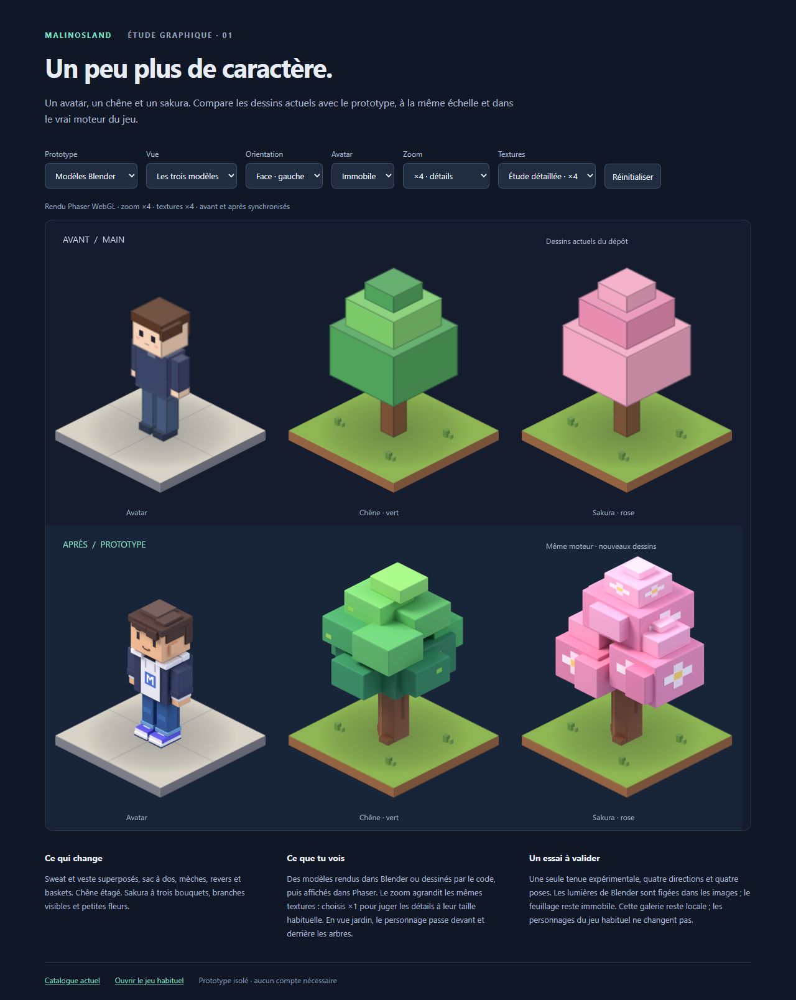
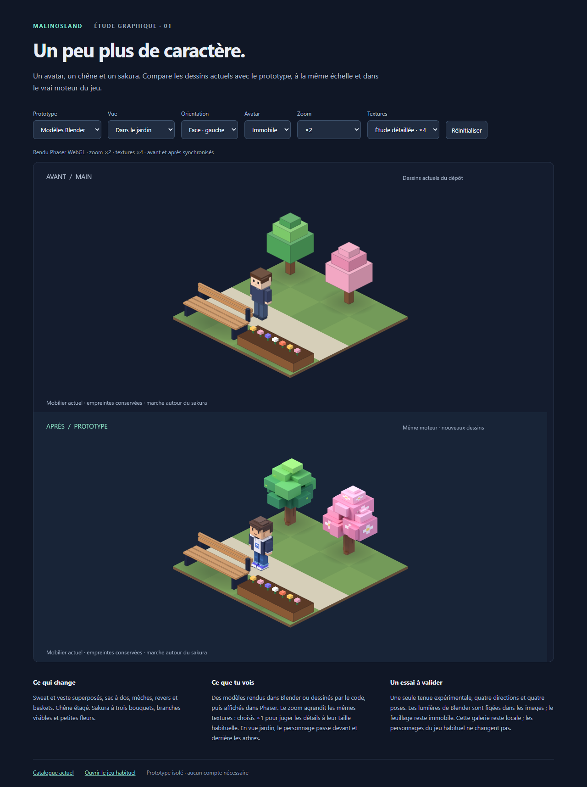

# Atelier voxel : avatar, chêne et sakura

> **En bref** : un prototype local à juger avant toute adoption. La galerie compare les graphismes
> actuels à un avatar en veste, un chêne plus fourni et un sakura à trois bouquets. Deux rendus sont
> proposés : dessin procédural et modèles Blender pré-rendus. Aucun déploiement ni changement de compte.

## Ouvrir la comparaison

### Essai directement dans le jeu

Après `npm ci` puis `npm run dev -- --host 127.0.0.1 --port 5173 --strictPort`, ouvrir
<http://127.0.0.1:5173/jouer/?prototype=voxel>.
L'avatar arrive dans le jardin du **vrai Hub**, près d'un chêne amélioré et de deux nouveaux
sakuras. Cliquer au sol ou utiliser ZQSD / les flèches pour marcher ; la molette règle le zoom.
Les autres arbres servent de comparaison. Le lien en bas revient au jeu habituel.

Aucun compte nécessaire. L'essai reste solo même si un serveur est configuré. Ses réglages et
sa progression utilisent un stockage séparé, sans modifier le profil habituel. La tenue du
personnage est fixe : l'éditeur d'avatar ne personnalise pas cette image expérimentale.
Il s'agit d'images PNG rendues une fois dans Blender, **pas de fichiers 3D téléchargés en jeu** :
avatar 765 345 octets, chêne 307 495 octets et nouveau sakura 307 384 octets, soit environ
**1,38 Mo** pour les trois atlas, réutilisés pour chaque exemplaire. Le build public ne les inclut pas.

Reproduire le nouvel atlas après avoir généré `screenshots/sakura-study/sakura.blend` :

```powershell
& 'C:\Program Files\Blender Foundation\Blender 5.2\blender.exe' --background screenshots/sakura-study/sakura.blend --python-exit-code 1 --python scripts/render-sakura-game.py
npm run prototype:pack
```

Le pack assemble également les anciens rendus (générés avec la procédure ci-dessous).
Le script de conversion fonctionne aussi via le MCP Blender, après ouverture de `sakura.blend`.
Il retire le socle de présentation, adapte la projection à Phaser et ne réenregistre pas le modèle.

Vérification : `npm run check` (215 tests) et `npm run test:prototype-game`.
Le second test couvre les trois arbres, les 16 cadres du personnage, les quatre orientations
des arbres sans débordement, la marche, les collisions, l'occultation devant/derrière un sakura,
un banc, le retour d'un logement, la conservation du profil et l'absence des images dans `dist`.
La fluidité sur un téléphone réel et tous les meubles restent à valider.

### Étude isolée et ancienne galerie

**Nouvelle étude après retour artistique :** ouvrir <http://127.0.0.1:5173/sakura.html>.
La page montre uniquement le nouveau sakura : trois bouquets volumineux, une fourche visible
et des fleurs composées de petits cubes. Le modèle est construit directement dans Blender,
avec des proportions libres, désormais adaptées à l'essai local du Hub. Il ne remplace
pas encore le sakura de l'ancienne galerie. Reproduction :

```powershell
& 'C:\Program Files\Blender Foundation\Blender 5.2\blender.exe' --background --factory-startup --python-exit-code 1 --python scripts/sakura-study.py -- screenshots/sakura-study
```

Le dossier contient `sakura.blend` et son rendu `sakura.png`. La présentation utilise une copie
du rendu dans `docs/images/sakura-study.png`, sans dépendance ni service externe.

Depuis une copie du dépôt, avec Node.js 22 et Git :

```bash
git fetch origin
git switch feature/prototype-voxel-avatar-arbres
npm ci
npm run dev -- --host 127.0.0.1 --port 5173 --strictPort
```

Ouvrir <http://127.0.0.1:5173/voxel-preview.html>.
Si le port est occupé, arrêter l'autre serveur ou choisir un autre port et adapter l'adresse.
Cette page se consulte avec le serveur de développement, **pas avec `npm run preview`**.

- **Prototype** : modèles Blender (par défaut), ou dessin procédural.
- **Vue** : les trois modèles sur des socles identiques ; ou le même petit jardin avant/après.
- **Orientation** : quatre vues, face et dos. Dans le jardin, ce réglage tourne les modèles,
  pas la caméra ni le mobilier. Pendant la marche, la direction du personnage suit son trajet.
- **Avatar** : immobile, marche (cycle de quatre images) ou pose assise. La pose assise est
  présentée seule : elle ne constitue pas une validation de tous les sièges du Hub.
- **Zoom ×1** : taille logique du jeu, un pixel logique pour un pixel CSS. **×4** : examiner les détails.
- **Textures** : ×1 basse, ×2 normale (comme le jeu), ×4 réservée à l'étude détaillée. Changer
  la résolution ou le rendu recharge la page pour libérer les anciennes textures.
- Petit écran : faire défiler la galerie horizontalement ; l'échelle reste identique à celle
  d'un écran large. Les réglages sont conservés dans l'adresse, sans stockage de profil.

Vue détaillée :
<http://127.0.0.1:5173/voxel-preview.html?render=blender&view=models&rotation=0&pose=idle&zoom=4&quality=4>.

Le jeu habituel reste consultable sur <http://127.0.0.1:5173/jouer/> ; son Hub n'utilise pas
les nouveaux modèles. Aucun fichier `.env`, compte, serveur Cloudflare ou accès Supabase n'est nécessaire.





## Ce qui a été réalisé

Les trois illustrations fournies par le responsable le 23 octobre 2026 servent de références :

- Avatar : veste marine, sweat clair avec M, mèches brunes, sac à dos turquoise, jean à revers,
  baskets violettes et blanches. Les quatre orientations et quatre poses partagent une ancre aux pieds.
- Chêne : groupes de feuillage étagés, verts différents, détails de feuilles et écorce.
- Sakura : trois bouquets roses plus fournis après le premier retour du responsable, branches,
  écorce et fleurs claires à cœur jaune. Les arbres gardent une empreinte logique de 1 × 1 ;
  leur feuillage dépasse légèrement, comme une couronne d'arbre.

L'illustration du monde sert d'ambiance, sans réaménagement du Hub. Ce sont des interprétations
originales construites par le code : les illustrations ne sont pas utilisées comme des textures.

## Architecture et isolation

- `src/game/art/prototype/` décrit les volumes avec l'`IsoBuilder` existant. Projection 2:1,
  couleurs par face, rotations et ancrage compatibles avec le moteur.
- `renderAvatarFrames` assemble les 16 vues. Cadres et ancres arrondis en pixels entiers avec
  une marge suffisante : cela évite le débordement d'une pose dans le cadre voisin.
- `TextureFactory` accepte un fournisseur facultatif de dessins ou de rendus. Ses clés séparent
  les textures actuelles et expérimentales ; aucun fournisseur alternatif n'est passé par le jeu.
- `src/dev/voxelPreview.ts` utilise **Phaser 4 et TextureFactory**, avec les mêmes sols de
  comparaison et le mobilier existant. La marche en jardin vérifie un exemple d'occultation,
  sans lancer les services de compte ou de réseau du jeu.
- `src/dev/blenderArt.ts` charge trois atlas PNG, seulement dans cette galerie. Lumières, arêtes
  adoucies et ombres entre volumes sont calculées une fois dans Blender ; aucun moteur 3D n'est
  ajouté au navigateur. La galerie et les atlas ne font pas partie des entrées de `vite build`.
- Aucun changement de carte, de profil d'avatar, de protocole réseau, de dépendance ou de base.

Les atlas Blender ajoutent environ **1,4 Mo** à la galerie, contre zéro image téléchargée pour
la version procédurale. Le mode ×4 est destiné à examiner les modèles ; les résolutions ×1 et ×2
permettent de juger le résultat avec le budget habituel du jeu. Blender n'est pas nécessaire pour
ouvrir la galerie : les atlas sont déjà présents dans la branche.

## Refaire ou modifier les modèles Blender

Blender **4.4.3** a été vérifié et utilisé en local. Aucun MCP, service de génération payant,
clé API, téléchargement de modèle ni extension n'est utilisé. Le script travaille dans un
processus vierge et n'ouvre aucun fichier personnel. Les modèles restent sous la licence du dépôt.

Dans un deuxième terminal, avec Vite encore lancé :

```bash
npm run prototype:export
```

Cela produit `art-source/voxel-models.json` à partir des mêmes dessins TypeScript, sans recopier
manuellement la géométrie. Puis, si Blender est dans le PATH :

```bash
blender --background --factory-startup --python-exit-code 1 --python scripts/render-voxel-blender.py -- art-source/voxel-models.json screenshots/blender-frames
npm run prototype:pack
npx prettier --write art-source/voxel-models.json
```

Sur le PC du responsable (PowerShell), la commande Blender est :

```powershell
& 'C:\Program Files\Blender Foundation\Blender 5.2\blender.exe' --background --factory-startup --python-exit-code 1 --python scripts/render-voxel-blender.py -- art-source/voxel-models.json screenshots/blender-frames
```

Le script produit 24 vues (16 pour l'avatar, 4 par arbre) et trois fichiers éditables :
`avatar-py-idle.blend`, `oak-0.blend`, `sakura-0.blend`, dans `screenshots/blender-frames/`.
Il vérifie mathématiquement la projection et l'ancre des images. Les boîtes ont des arêtes
légèrement adoucies ; le rendu utilise Cycles sur le processeur. Aucun GPU particulier n'est requis.
Les dossiers générés `screenshots/` et `art-source/` sont ignorés par Git ; les sources TypeScript,
les scripts de génération et les atlas reproductibles sont versionnés.

Une retouche faite uniquement dans un `.blend` ne remonte pas automatiquement dans les dessins
TypeScript. Pour conserver les deux rendus cohérents, modifier les volumes dans `prototype/`,
puis relancer l'export et les rendus. Les fichiers Blender sont aussi utilisables pour une future
direction artistique distincte, à décider avant intégration dans le jeu.

## Vérifier

```bash
npm run check
npm run format:check
npm run test:voxel
```

Le dernier test demande le serveur Vite sur le port 5173 et un Chrome installé. Il détecte les
emplacements usuels ; sinon définir `CHROMIUM_PATH`. Un autre port et un autre dossier de captures :

```bash
npm run test:voxel -- http://127.0.0.1:5174 screenshots/voxel
```

Le test examine les cadres réels, leur marge transparente, les vues et poses, le cadrage à ×1
et ×4, le cache lors des changements répétés, le passage devant/derrière, l'écran étroit et
l'absence de requêtes externes. Il couvre les deux rendus, les résolutions ×1/×2/×4 et produit
des captures et un rapport `verification.json` dans `screenshots/voxel/`.
La CI exécute aussi ce test dans le job navigateur et conserve les captures avec celles du jeu.

Le parcours de non-régression du jeu se lance séparément :

```bash
npm run build
npm run preview -- --host 127.0.0.1 --port 4173 --strictPort
```

Puis, dans un autre terminal :

```powershell
$env:CHROMIUM_PATH = 'C:\Program Files\Google\Chrome\Application\chrome.exe'
npm run test:e2e -- http://127.0.0.1:4173/ screenshots/smoke
```

## Limites et décisions en attente

Vérifications exécutées le **23/10/2026**, Node 22.23.2, Chrome 156.0.8078.47, Blender 4.4.3 :
`npm run check` (215 tests), `npm run format:check`, `npm run test:voxel` (deux rendus,
trois résolutions, quatre orientations et trois modes, soit 144 combinaisons de vue/pose),
`npm run test:e2e` sur le build local : **réussis**. Aucune erreur JavaScript ni requête externe
dans la galerie. Captures inspectées de face, de dos et dans le jardin. Les mesures de ce
navigateur automatisé en rendu logiciel ne constituent pas une mesure de fluidité sur appareil réel.

Le build a aussi été inspecté : ni page `voxel-preview.html`, ni atlas Blender, ni modules de
l'atelier dans `dist/`. Les 24 rendus Blender ont été générés localement avec succès.

- **Validation artistique en attente** : ce prototype n'est pas une reproduction identique des
  illustrations. Les détails deviennent nécessairement très petits à l'échelle normale.
- Un seul personnage expérimental. Les autres coiffures, morphologies, accessoires et barbes
  restent ceux du jeu ; la tenue du prototype n'est pas ajoutée à l'éditeur d'avatar.
- Pas de squelette articulé ou de vraie 3D interactive : quatre poses et quatre orientations
  précalculées, comme le principe actuel. La pose assise n'a pas été validée dans tous les meubles.
- Le soleil, la caméra et les ombres de Blender sont figés dans les images. Le feuillage et les
  pétales ne sont pas animés. Aucun test du rendu sur un vrai téléphone ou sur un ordinateur ancien.
- L'occultation devant/derrière et les trois placements sont vérifiés dans le vrai Hub pour
  l'essai local ; un remplacement généralisé des arbres reste à évaluer avant adoption.
- Avant toute intégration : choisir le rendu et ses compromis (poids d'images, génération,
  personnalisation), puis valider la taille, le style et les performances dans le monde complet.
- Branche `feature/prototype-voxel-avatar-arbres`, fondée sur `main` à `23b8d84` (PR #46 incluse).
  Aucun déploiement ; aucune fusion dans `main`. La proposition doit rester en brouillon jusqu'à
  l'approbation explicite du responsable. La fusion automatique du dépôt était désactivée lors de la vérification.
