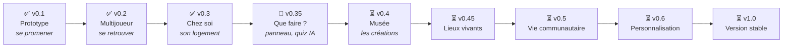

# Feuille de route

Cette page explique **où va MalinosLand**, étape par étape. Chaque version ajoute quelque chose de
concret et reste jouable : on ne construit pas tout d’un coup.

**Légende :** ✅ terminé · 🔶 en cours · 🔜 prochaine étape · ⏳ prévu plus tard.

> **Pourquoi cet ordre ?** Il faut d’abord un monde agréable (0.1), puis pouvoir s’y retrouver à
> plusieurs (0.2) et avoir un chez-soi (0.3). Ensuite, le plus important est que chacun sache
> **quoi faire**, même seul (0.35), puis puisse **découvrir les créations** de la communauté (0.4).
> Les événements (0.5) viendront quand la communauté le demandera. Plan détaillé :
> [PLAN_EVOLUTION.md](PLAN_EVOLUTION.md).

---

## ✅ Version 0.1 — Le prototype : « se promener »

**En une phrase :** on découvre le Hub, on crée son personnage et on utilise les objets.

**Ce que tu peux faire :**

- créer et modifier ton avatar (silhouette, coiffure, couleurs, accessoires) ;
- te promener à la souris ou au clavier dans le hall, le coworking, la salle de conférence, le
  salon, le jardin et la terrasse ;
- parler à Joshua, t’asseoir, prendre un café, appeler l’ascenseur, lire les panneaux ;
- suivre les 8 objectifs « Premiers pas », écrire dans le chat, envoyer des émotes.

**Ses limites (normales pour un prototype) :**

- pas de compte : ton personnage est enregistré dans ton navigateur ;
- pas de vrai multijoueur en ligne (seulement une démonstration entre onglets du même navigateur) ;
- le jeu n’est pas encore mis en ligne : il faut le lancer sur son ordinateur.

**Reste à faire :** mesurer la fluidité sur de vrais ordinateurs (vieux portable, PC récent…).
Tu peux aider : voir [TESTING.md](TESTING.md#protocole-de-mesure-manuel).

---

## ✅ Version 0.2 — Le multijoueur : « se retrouver »

**En une phrase :** on se connecte avec un compte et on voit les autres Malinos bouger et parler
en direct.

**Pour les joueurs :**

- connexion simple et facultative avec un compte GitHub ou Google ;
- ton avatar et ton pseudo sont sauvegardés et te suivent sur tous tes appareils ;
- tu vois qui est en ligne, tu croises les autres dans le Hub ;
- chat de proximité (les gens autour de toi) et chat général (tout le monde) ;
- tu peux **signaler** ou **masquer** quelqu’un qui dérange ;
- le jeu est **en ligne** : une simple adresse à ouvrir, rien à installer.

**Où en est-on ?**

- ✅ **Le serveur temps réel est prêt** et testé sur ordinateur : deux joueurs dans deux
  navigateurs différents se voient bouger, discutent et se croisent dans le Hub.
- ✅ Les protections sont en place : anti-spam, anti-téléportation, 40 joueurs maximum par salle,
  et un **budget quotidien** qui ralentit le jeu puis le met en pause avant la limite gratuite.
- ✅ **Le jeu est en ligne** depuis le 19/10/2026 : [malinosland.pages.dev](https://malinosland.pages.dev) (offre gratuite
  Cloudflare).
- ✅ **Comptes joueurs** (facultatifs, GitHub ou Google) : en ligne depuis le 19/10/2026 (voir
  [COMPTES.md](COMPTES.md)).
  Avec un compte : personnage retrouvé partout, pseudo réservé, marque ✓, suppression du compte
  en un clic.
- ✅ **Masquer** un joueur qui dérange, le **signaler** à l’équipe (avec un compte), page de
  modération pour l’équipe.
- ✅ **Boîte à idées** et **borne à bugs** dans le hall, protégées des robots (Cloudflare
  Turnstile) pour les visiteurs.
- ✅ **Confort** : statut « absent », sons discrets, mentions @pseudo, ambiance sonore selon le
  lieu, interface pensée pour le téléphone (chat repliable, bouton d’action, zoom à deux doigts).
- ✅ **File d’attente** quand une salle est pleine (40 personnes) : on entre tout seul dès qu’une
  place se libère.

**Point important — la gratuité :** les services en ligne gratuits ont des limites. Si un jour
trop de monde joue en même temps, le jeu **ralentira ou mettra les gens en file d’attente**, mais
il ne coûtera **jamais** d’argent. Explications : [FREE_INFRASTRUCTURE.md](FREE_INFRASTRUCTURE.md).

---

## ✅ Version 0.3 — Les espaces personnels : « chez soi »

**En une phrase :** chaque Malino reçoit son propre logement dans la Tour communautaire.

**Pour les joueurs :**

- ✅ **Mon logement** : un studio meublé par compte, par l’ascenseur du hall ;
- ✅ accès **personne**, **sur invitation** ou **tout le monde**, **invitations** reçues en
  direct, retrait d’accès et mise à la porte, vérifiés par le serveur et la base de données ;
- ✅ **discussion privée** : ce qui s’écrit dans un logement n’est lu que par les présents ;
- ✅ **éditeur de décoration** : 21 meubles, poser / tourner / couleur / déplacer / ranger,
  visiteurs mis à jour en direct.

**En plus, pendant cette version :** le **carnet de Joshua** (devinettes des 10 secrets, gardé
sur le compte), **Joshua vivant** (humeurs, répliques), la **ronde des champignons**, le **statut
doré** et les **modérateurs** nommés depuis le jeu, la **barbe** et le **micro** pour les
avatars, et le **jour et la nuit** à l’heure de Paris.

**Sécurité :** les droits d’entrée sont vérifiés par le serveur, pas seulement par le jeu : impossible
de forcer la porte d’un logement privé.

**Reste à vérifier en ligne par le responsable** : voir la liste dans
[SESSION_HANDOFF.md](SESSION_HANDOFF.md#tests-à-faire-en-ligne).

---

## 🔶 Version 0.35 — « Que faire maintenant ? »

**En une phrase :** en arrivant, on sait tout de suite quoi faire, et on peut s’amuser même seul.

- un **écran « Que faire maintenant ? »** près de Joshua (et un bouton 🧭) : 4 ou 5 idées du
  moment (défi du quiz, prochain objectif, secret à chercher, studios ouverts, Malinos présents),
  chacune avec un bouton **« Y aller »** ;
- le **Quiz IA des Malinos** sur une borne de la salle de jeux : 5 questions avec explication, en
  partie libre ou en **défi de la semaine** (le même pour tous) ; scores gardés dans ton
  navigateur ;
- des **mesures de fréquentation** simples pour le responsable, sans nouvelle collecte.

Rien de tout cela ne sollicite le serveur ni la base de données : c’est calculé dans le navigateur.

---

## ⏳ Version 0.4 — Le Musée des Malinos

**En une phrase :** les Malinos exposent leurs créations (sites, applis, outils IA, jeux, projets
open source) et tout le monde peut les découvrir dans le jeu.

- **exposer son projet** avec un compte : titre, résumé, adresse, catégorie ; **validé par les
  modérateurs** avant d’apparaître, retiré quand on veut ;
- le musée ouvre dans la **galerie déjà construite** à côté du hall : des **stands** avec une
  **affiche dessinée par le jeu** pour chaque projet, et une borne qui liste toutes les créations ;
- une **fiche** par projet, un bouton **« Ouvrir le site »**, et **« Essayer ici »** pour les
  sites qui l’acceptent (chargé seulement après un clic, dans une fenêtre isolée) ;
- le **chantier** devient la promesse du **Bâtiment des créations**, qui accueillera
  l’agrandissement du musée.

**Sécurité :** projets vérifiés avant publication, droits contrôlés par la base, signalement et
retrait ; MalinosLand ne copie jamais le site d’un membre et ne sert jamais d’intermédiaire.

---

## ⏳ Version 0.45 — Des lieux plus vivants

- les ordinateurs du **coworking** présentent des ressources choisies par la communauté ;
- au **feu de camp** : des histoires de Joshua qui changent et la guitare ;
- un **secret de la semaine** ;
- les **studios ouverts** mis en avant.

---

## ⏳ Version 0.5 — La vie communautaire

**En une phrase :** des choses à faire ensemble, quand la communauté le souhaite.

- **agenda des événements** dans la salle de conférence (présentations, démos, lives), avec un
  lien vers un outil de visio gratuit externe : annoncé « bientôt » tant qu’il n’est pas utilisé ;
- premiers **mini-jeux à plusieurs** ;
- **défis créatifs** et expositions temporaires au musée.

---

## ⏳ Version 0.6 — La personnalisation

- les **Coins coins** 🦆 : de petites récompenses personnelles pour débloquer des bonus
  cosmétiques (jamais d’argent réel, aucun classement) ;
- nouvelles décorations, suite du mystère de Joshua ;
- plus tard, à discuter : étages de la Tour et annuaire des membres.

---

## ⏳ Version 1.0 — L’univers communautaire stable

**En une phrase :** un monde complet, sûr et durable.

- espaces personnels aboutis et outils de contribution faciles ;
- modération solide (rôles de modérateurs, signalements, suspensions) ;
- documentation complète, performances et sécurité vérifiées ;
- infrastructure toujours **100 % gratuite** et maîtrisée.

---

## Comment la feuille de route évolue

La feuille de route n’est pas figée : **elle bouge selon vos retours.**

- 💡 Une idée ? Ouvre une [issue « Idée »](https://github.com/Rogue06/MalinosLand/issues/new/choose).
- 👍 Tu aimes une idée existante ? Ajoute une réaction 👍 : ça aide à fixer les priorités.
- 📋 La liste détaillée des fonctionnalités, avec leurs priorités et dépendances, est dans
  [FEATURE_BACKLOG.md](FEATURE_BACKLOG.md).
- 🧭 Les choix importants sont expliqués dans [DECISIONS.md](DECISIONS.md).

## Suivi détaillé (pour les contributeurs)

Cliquer pour voir la liste détaillée des tâches par version

### v0.1 — branche `feature/initial-prototype`

- ✅ Application web (Vite + TypeScript + Phaser 4 + Preact)
- ✅ Carte isométrique originale du Hub (8 zones dont 2 « bientôt »)
- ✅ Avatar personnalisable, déplacements souris/clavier, collisions, caméra, zoom
- ✅ ≈ 40 objets procéduraux, interactions réelles, objectifs, chat, émotes
- ✅ Démo multi-onglets locale, réglages de qualité
- ✅ Documentation, tests automatiques, test complet dans le navigateur, CI
- ⬜ Mesures de performance sur machines réelles

### v0.2

- ✅ Comptes facultatifs (Supabase Auth, GitHub + Google), profil en base, marque ✓ vérifiée
  par le serveur · ✅ anti-robots (Turnstile) pour la boîte à idées des visiteurs
- ✅ Serveur temps réel (Cloudflare Worker + Durable Object) et transport réseau associé
- ✅ Présence, synchronisation des déplacements, chat local/général
- ✅ Suppression de compte (RGPD) · ✅ masquer / signaler, page de modération
- ✅ Compteur de messages quotidien et dégradation contrôlée, plafond par salle
- ✅ File d’attente quand une salle est pleine (50 places, entrée automatique)
- ✅ Boîte à idées / borne à bugs, statut « absent », sons et mentions, confort mobile
- ➖ Historique du chat : abandonné (rien n’est conservé ; les mentions suffisent)
- ✅ Mise en ligne gratuite (Cloudflare Pages + Worker) : https://malinosland.pages.dev

### v0.3

- ✅ Logements (studio), modes d’accès vérifiés côté serveur et par la base, invitations,
  mise à la porte, discussion privée
- ✅ Éditeur de décoration, catalogue de meubles, sauvegarde des dispositions
- ✅ Carnet de Joshua, progression sur le compte, Joshua vivant, ronde des champignons
- ✅ Statut doré, modérateurs nommés depuis le jeu, barbe et micro, jour et nuit

### v0.35 — voir [PLAN_EVOLUTION.md](PLAN_EVOLUTION.md) §10, PR 2 à 6

- ✅ Panneau « Que faire maintenant ? » : moteur de suggestions, bouton 🧭 et écran du hall
- ✅ Quiz IA des Malinos : borne de la salle de jeux, défi de la semaine, 60 questions
- ✅ Mesures de fréquentation du responsable (journal existant, sans nouvelle collecte)

### v0.4 — PR 7 à 11

- ⬜ Musée : base des projets, soumission, modération, stands, fiche, démo isolée

### v0.45, v0.5, v0.6

- ⬜ Coworking, feu de camp, secret de la semaine, studios ouverts
- ⬜ Agenda, mini-jeux à plusieurs, défis
- ⬜ Coins coins, décorations

