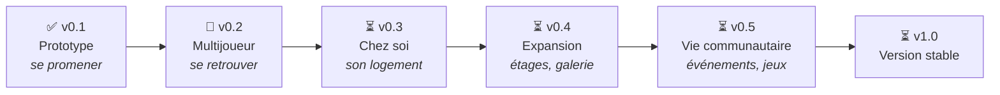

# Feuille de route

Cette page explique **où va MalinosLand**, étape par étape. Chaque version ajoute quelque chose de
concret et reste jouable : on ne construit pas tout d’un coup.

**Légende :** ✅ terminé · 🔶 en cours · 🔜 prochaine étape · ⏳ prévu plus tard.

> **Pourquoi cet ordre ?** Il faut d’abord un monde agréable (0.1), puis pouvoir s’y retrouver à
> plusieurs (0.2). Les logements (0.3) ont besoin des comptes, la galerie et les étages (0.4) ont
> besoin des logements et de la modération, et les événements (0.5) ont besoin de monde !

---

## ✅ Version 0.1 — Le prototype : « se promener »

**En une phrase :** on découvre le Hub, on crée son personnage et on utilise les objets.

**Ce que tu peux faire :**

- créer et modifier ton avatar (silhouette, coiffure, couleurs, accessoires) ;
- te promener à la souris ou au clavier dans le hall, le coworking, la salle de conférence, le
  salon, le jardin et la terrasse ;
- parler à Joshua, t’asseoir, prendre un café, appeler l’ascenseur, lire les panneaux ;
- suivre les 8 objectifs « Premiers pas », écrire dans le chat, envoyer des émotes.

**Ses limites (normales pour un prototype) :**

- pas de compte : ton personnage est enregistré dans ton navigateur ;
- pas de vrai multijoueur en ligne (seulement une démonstration entre onglets du même navigateur) ;
- le jeu n’est pas encore mis en ligne : il faut le lancer sur son ordinateur.

**Reste à faire :** mesurer la fluidité sur de vrais ordinateurs (vieux portable, PC récent…).
Tu peux aider : voir [TESTING.md](TESTING.md#protocole-de-mesure-manuel).

---

## 🔶 Version 0.2 — Le multijoueur : « se retrouver »

**En une phrase :** on se connecte avec un compte et on voit les autres Malinos bouger et parler
en direct.

**Pour les joueurs :**

- connexion simple (lien reçu par e-mail, ou compte GitHub / Discord) ;
- ton avatar et ton pseudo sont sauvegardés et te suivent sur tous tes appareils ;
- tu vois qui est en ligne, tu croises les autres dans le Hub ;
- chat de proximité (les gens autour de toi) et chat général (tout le monde) ;
- tu peux **signaler** ou **masquer** quelqu’un qui dérange ;
- le jeu est **en ligne** : une simple adresse à ouvrir, rien à installer.

**Où en est-on ?**

- ✅ **Le serveur temps réel est prêt** et testé sur ordinateur : deux joueurs dans deux
  navigateurs différents se voient bouger, discutent et se croisent dans le Hub.
- ✅ Les protections sont en place : anti-spam, anti-téléportation, 40 joueurs maximum par salle,
  et un **budget quotidien** qui ralentit le jeu puis le met en pause avant la limite gratuite.
- ✅ **Le jeu est en ligne** depuis le 19/10/2026 : [malinosland.pages.dev](https://malinosland.pages.dev) (offre gratuite
  Cloudflare).
- 🔶 **Comptes joueurs** (facultatifs, GitHub ou Google) : développés et testés, base de données
  créée ; il reste à brancher GitHub et Google dans les réglages (voir [COMPTES.md](COMPTES.md)).
  Avec un compte : personnage retrouvé partout, pseudo réservé, marque ✓, suppression du compte
  en un clic.
- ⬜ Signaler / masquer un joueur.

**Point important — la gratuité :** les services en ligne gratuits ont des limites. Si un jour
trop de monde joue en même temps, le jeu **ralentira ou mettra les gens en file d’attente**, mais
il ne coûtera **jamais** d’argent. Explications : [FREE_INFRASTRUCTURE.md](FREE_INFRASTRUCTURE.md).

---

## ⏳ Version 0.3 — Les espaces personnels : « chez soi »

**En une phrase :** chaque Malino reçoit son propre logement dans la Tour communautaire.

**Pour les joueurs :**

- un logement **privé par défaut** ;
- tu choisis qui peut entrer : **personne**, **sur invitation** ou **tout le monde** ;
- tu peux inviter des amis et retirer un accès à tout moment ;
- un **éditeur de décoration** simple : choisir un meuble, le poser sur une grille, le tourner,
  le supprimer, enregistrer — sans aucune connaissance technique ;
- un catalogue de meubles partagé (bureaux, plantes, étagères, ordinateurs…).

**Sécurité :** les droits d’entrée sont vérifiés par le serveur, pas seulement par le jeu : impossible
de forcer la porte d’un logement privé.

---

## ⏳ Version 0.4 — L’expansion : « le monde s’agrandit »

**En une phrase :** de nouveaux étages, un ascenseur qui fonctionne et la **Galerie des Malinos**.

**Pour les joueurs :**

- l’**ascenseur** mène aux étages de la tour (chargés seulement quand on y va : la tour peut
  accueillir des centaines de logements sans ralentir le jeu) ;
- la **Galerie des Malinos** : un musée de vos créations (sites, applis, projets IA, dépôts GitHub).
  On s’approche d’une œuvre, on lit sa fiche, on ouvre le lien ;
- un **annuaire** pour trouver un membre et découvrir ses espaces publics ;
- de nouvelles salles proposées par la communauté.

**Sécurité :** les projets exposés sont **vérifiés avant publication** et les liens sont sécurisés.

---

## ⏳ Version 0.5 — La vie communautaire

**En une phrase :** des choses à faire ensemble.

- **Événements** dans la salle de conférence (présentations, démos), avec un lien vers un outil de
  visio gratuit externe ;
- **expositions temporaires** dans la galerie (projets du mois, créations IA…) ;
- **défis créatifs** (construction, développement) ;
- premiers **mini-jeux** sur la borne d’arcade, ajoutés comme des modules indépendants.

---

## ⏳ Version 1.0 — L’univers communautaire stable

**En une phrase :** un monde complet, sûr et durable.

- espaces personnels aboutis et outils de contribution faciles ;
- modération solide (rôles de modérateurs, signalements, suspensions) ;
- documentation complète, performances et sécurité vérifiées ;
- infrastructure toujours **100 % gratuite** et maîtrisée.

---

## Comment la feuille de route évolue

La feuille de route n’est pas figée : **elle bouge selon vos retours.**

- 💡 Une idée ? Ouvre une [issue « Idée »](https://github.com/Rogue06/MalinosLand/issues/new/choose).
- 👍 Tu aimes une idée existante ? Ajoute une réaction 👍 : ça aide à fixer les priorités.
- 📋 La liste détaillée des fonctionnalités, avec leurs priorités et dépendances, est dans
  [FEATURE_BACKLOG.md](FEATURE_BACKLOG.md).
- 🧭 Les choix importants sont expliqués dans [DECISIONS.md](DECISIONS.md).

## Suivi détaillé (pour les contributeurs)

Cliquer pour voir la liste détaillée des tâches par version

### v0.1 — branche `feature/initial-prototype`

- ✅ Application web (Vite + TypeScript + Phaser 4 + Preact)
- ✅ Carte isométrique originale du Hub (8 zones dont 2 « bientôt »)
- ✅ Avatar personnalisable, déplacements souris/clavier, collisions, caméra, zoom
- ✅ ≈ 40 objets procéduraux, interactions réelles, objectifs, chat, émotes
- ✅ Démo multi-onglets locale, réglages de qualité
- ✅ Documentation, tests automatiques, test complet dans le navigateur, CI
- ⬜ Mesures de performance sur machines réelles

### v0.2

- 🔶 Comptes facultatifs (Supabase Auth, GitHub + Google), profil en base, marque ✓ vérifiée
  par le serveur — reste la configuration GitHub / Google ; anti-robots (Turnstile) plus tard
- ✅ Serveur temps réel (Cloudflare Worker + Durable Object) et transport réseau associé
- ✅ Présence, synchronisation des déplacements, chat local/général
- ✅ Suppression de compte (RGPD) · ⬜ signaler / masquer
- ✅ Compteur de messages quotidien et dégradation contrôlée, plafond par salle
- ⬜ File d’attente quand une salle est pleine (aujourd’hui : message « salle pleine » et
  nouvel essai automatique une minute plus tard)
- ✅ Mise en ligne gratuite (Cloudflare Pages + Worker) : https://malinosland.pages.dev

### v0.3

- ⬜ Logements, modes d’accès vérifiés côté serveur, invitations
- ⬜ Éditeur de décoration, catalogue partagé, sauvegarde des dispositions

### v0.4

- ⬜ Étages chargés à la demande, ascenseur fonctionnel
- ⬜ Galerie (soumission, modération, fiches), annuaire, outils d’administration

### v0.5

- ⬜ Événements, expositions, défis, mini-jeux modulaires

